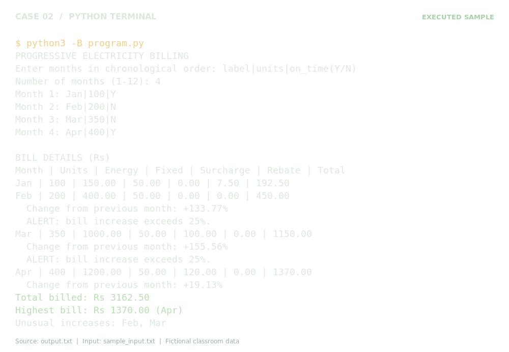

# Case 02: Progressive Electricity Billing

[← Portfolio index](../README.md) · [Complete report](../REPORT.html)

## Problem statement

Calculate household electricity bills using progressive consumption slabs, a fixed charge, a surcharge, and an on-time rebate. Compare a chronological sequence of monthly bills, identify increases greater than a specified threshold, and report every month tied for the highest bill.

## Objectives

- Apply progressive slabs without charging all units at the highest rate.
- Use conditional rules for surcharge, rebate, and unusual bill increases.
- Store monthly records as tuples in a list and unpack them during processing.
- Preserve exact paise amounts while calculating and rounding charges.

## Assumptions and policy

- The supplied brief gives no tariff values. The following rates are classroom assumptions, not an electricity provider's tariff.
- Accept 1-12 months in chronological order, with unique labels of 1-12 characters. Labels are compared without regard to case. Units are nonnegative whole kWh.
- The first 100 units cost Rs 1.50 each, the next 100 cost Rs 2.50 each, and every unit above 200 costs Rs 4.00. Fixed charge: Rs 50.00 per month, including at zero consumption.
- Consumption above 300 units incurs a surcharge of 10% of the energy charge. At 100 units or less, on-time payment earns a rebate of 5% of the energy charge.
- Money is calculated in integer paise. Percentage charges are rounded half up to the nearest paise using (amount * rate + 50) // 100. Only display formatting converts to rupees.
- An unusual increase is strictly greater than 25% of the preceding final bill. Exactly 25% does not trigger an alert. There is no alert for the first month.
- Malformed month records are retried and do not consume a month slot. Highest-bill ties retain input order.

## Input and output

**Input:** First enter the month count. Then enter label|units|Y/N for each month. Y means payment by the due date. Example: Jan|100|Y.

**Output:** An itemized monthly bill, percentage change from the preceding month, alert labels, total billed amount, and all highest-bill month labels.

## Computational thinking

- Decomposition: separate input validation, energy slabs, adjustments, and trend reporting.
- Pattern recognition: each month follows the same tariff calculation.
- Abstraction: represent a month by only its label, consumption, and on-time flag.
- Algorithm design: scan the chronological list once, keeping the previous bill and the running maximum.

## Algorithm

1. Read and validate the month count.
2. Read each three-field record. Validate the label, units, and Y/N flag; retry invalid or duplicate records.
3. Store accepted records as (label, units, on_time) tuples.
4. For each month, calculate energy in paise using the three progressive slabs.
5. Calculate the applicable surcharge and rebate, round each to paise, and add the fixed charge.
6. Print the bill. From the second month onward, calculate percentage change and flag bill * 100 > previous_bill * 125.
7. Accumulate the grand total and maintain the highest bill and every tied label.
8. Print the total, highest-bill labels, and unusual-increase labels.

## Flowchart


[Scalable SVG](assets/flowchart.svg) · [Mermaid source](flowchart.mmd)

## Pseudocode

```text
START
READ a valid month_count in 1..12
months <- empty list; labels <- empty list
WHILE accepted months < month_count
    READ label, units, on_time
    IF record is invalid OR label already exists
        PRINT error; RETRY
    ELSE
        APPEND (label, units, on_time) to months
        APPEND normalized label to labels
previous_bill <- 0; highest_bill <- -1; total <- 0
FOR EACH (label, units, on_time) IN months
    IF units <= 100
        energy <- units * 150
    ELSE IF units <= 200
        energy <- 15000 + (units - 100) * 250
    ELSE
        energy <- 40000 + (units - 200) * 400
    surcharge <- 0; rebate <- 0
    IF units > 300: surcharge <- (energy * 10 + 50) DIV 100
    IF units <= 100 AND on_time = Y
        rebate <- (energy * 5 + 50) DIV 100
    bill <- energy + 5000 + surcharge - rebate
    PRINT itemized bill
    IF previous_bill > 0
        PRINT (bill - previous_bill) * 100 / previous_bill
        IF bill * 100 > previous_bill * 125: RECORD alert
    UPDATE highest bill and all ties
    total <- total + bill; previous_bill <- bill
PRINT total, highest-bill months, alert months
STOP
```

## Python source code

[Runnable source](program.py). From the repository root:

```bash
python3 02_electricity_billing/program.py
```

```python
print("PROGRESSIVE ELECTRICITY BILLING")
print("Enter months in chronological order: label|units|on_time(Y/N)")

month_count_text = input("Number of months (1-12): ").strip()
while not month_count_text.isascii() or not month_count_text.isdigit() or not 1 <= int(month_count_text) <= 12:
    print("ERROR: enter an integer from 1 to 12.")
    month_count_text = input("Number of months (1-12): ").strip()
month_count = int(month_count_text)

months = []
labels = []
while len(months) < month_count:
    fields = input(f"Month {len(months) + 1}: ").split("|")
    if len(fields) != 3:
        print("ERROR: expected label|units|Y/N.")
        continue
    label, units_text, on_time = fields
    label = label.strip()
    units_text = units_text.strip()
    on_time = on_time.strip().upper()
    if not 1 <= len(label) <= 12 or label.lower() in labels:
        print("ERROR: month labels must be nonempty, unique, and at most 12 characters.")
        continue
    if not units_text.isascii() or not units_text.isdigit():
        print("ERROR: units must be a nonnegative whole number.")
        continue
    if on_time not in ("Y", "N"):
        print("ERROR: on-time payment must be Y or N.")
        continue
    months.append((label, int(units_text), on_time))
    labels.append(label.lower())

print("\nBILL DETAILS (Rs)")
print("Month | Units | Energy | Fixed | Surcharge | Rebate | Total")
previous_bill = 0
highest_bill = -1
highest_months = []
unusual_months = []
grand_total = 0

for label, units, on_time in months:
    if units <= 100:
        energy = units * 150
    elif units <= 200:
        energy = 100 * 150 + (units - 100) * 250
    else:
        energy = 100 * 150 + 100 * 250 + (units - 200) * 400
    fixed = 5000
    surcharge = 0
    rebate = 0
    if units > 300:
        surcharge = (energy * 10 + 50) // 100
    if units <= 100 and on_time == "Y":
        rebate = (energy * 5 + 50) // 100
    bill = energy + fixed + surcharge - rebate
    grand_total += bill
    print(f"{label} | {units} | {energy / 100:.2f} | {fixed / 100:.2f} | {surcharge / 100:.2f} | {rebate / 100:.2f} | {bill / 100:.2f}")
    if previous_bill > 0:
        change = (bill - previous_bill) * 100 / previous_bill
        print(f"  Change from previous month: {change:+.2f}%")
        if bill * 100 > previous_bill * 125:
            unusual_months.append(label)
            print("  ALERT: bill increase exceeds 25%.")
    if bill > highest_bill:
        highest_bill = bill
        highest_months = [label]
    elif bill == highest_bill:
        highest_months.append(label)
    previous_bill = bill

print(f"Total billed: Rs {grand_total / 100:.2f}")
print(f"Highest bill: Rs {highest_bill / 100:.2f} ({', '.join(highest_months)})")
if len(unusual_months) == 0:
    print("Unusual increases: none")
else:
    print(f"Unusual increases: {', '.join(unusual_months)}")
```

## Test cases

Six automated fixtures cover normal, boundary, and validation behavior. Full stdin and assertions are in [tests.json](tests.json).

| Test | Type | Expected result | Actual result |
|---|---|---|---|
| `01_normal` | Normal | Bills: Rs 192.50, 450.00, 1150.00, 1370.00. Total Rs 3162.50. Alerts: Feb, Mar. | PASS · [raw stdout](test_outputs/01_normal.txt) |
| `02_slab_boundaries` | Boundary | Totals: 50.00, 200.00, 202.50, 450.00, 454.00, 850.00, 934.40, 51.42. At 1 unit, rebate rounds up to Rs 0.08. | PASS · [raw stdout](test_outputs/02_slab_boundaries.txt) |
| `03_exact_alert_boundary` | Boundary | Bills 200, 250, 250; no alerts; B and C share the highest bill. | PASS · [raw stdout](test_outputs/03_exact_alert_boundary.txt) |
| `04_decrease` | Normal | Bills 1370 and 50; change -96.35%; no alert. | PASS · [raw stdout](test_outputs/04_decrease.txt) |
| `05_invalid_inputs` | Validation | Invalid inputs are retried. Only Jan and Feb are billed, for a total of Rs 101.42. | PASS · [raw stdout](test_outputs/05_invalid_inputs.txt) |
| `06_rebate_cutoff` | Boundary | A gets Rs 7.50 rebate; B gets none. Total Rs 395.00. | PASS · [raw stdout](test_outputs/06_rebate_cutoff.txt) |

## Output screenshot

The image is a rendered capture of the actual pseudo-terminal execution of test `01_normal`. Typed sample inputs are visible in the transcript. Every sample is fictional.



[Full terminal transcript](output.txt) · [Exact sample input](sample_input.txt) · [Scalable output image](assets/output.svg)

```text
$ python3 -B program.py
PROGRESSIVE ELECTRICITY BILLING
Enter months in chronological order: label|units|on_time(Y/N)
Number of months (1-12): 4
Month 1: Jan|100|Y
Month 2: Feb|200|N
Month 3: Mar|350|N
Month 4: Apr|400|Y

BILL DETAILS (Rs)
Month | Units | Energy | Fixed | Surcharge | Rebate | Total
Jan | 100 | 150.00 | 50.00 | 0.00 | 7.50 | 192.50
Feb | 200 | 400.00 | 50.00 | 0.00 | 0.00 | 450.00
  Change from previous month: +133.77%
  ALERT: bill increase exceeds 25%.
Mar | 350 | 1000.00 | 50.00 | 100.00 | 0.00 | 1150.00
  Change from previous month: +155.56%
  ALERT: bill increase exceeds 25%.
Apr | 400 | 1200.00 | 50.00 | 120.00 | 0.00 | 1370.00
  Change from previous month: +19.13%
Total billed: Rs 3162.50
Highest bill: Rs 1370.00 (Apr)
Unusual increases: Feb, Mar
```

## Conclusion

The solution combines progressive arithmetic, conditional policies, and a running comparison without advanced Python features. Its boundary tests distinguish slab transitions, the 300-unit surcharge threshold, paise rounding, and an increase of exactly 25%.
