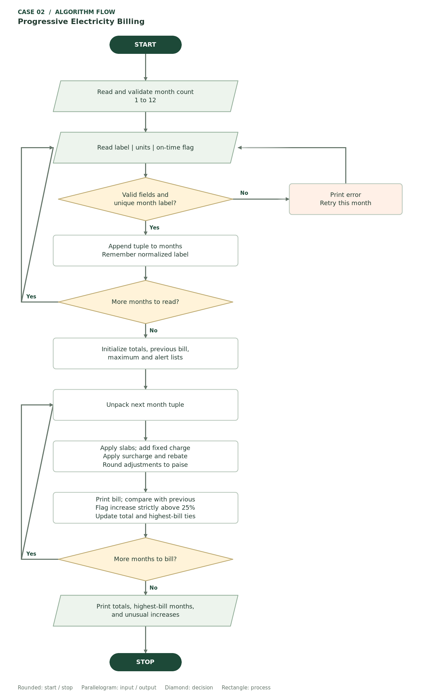
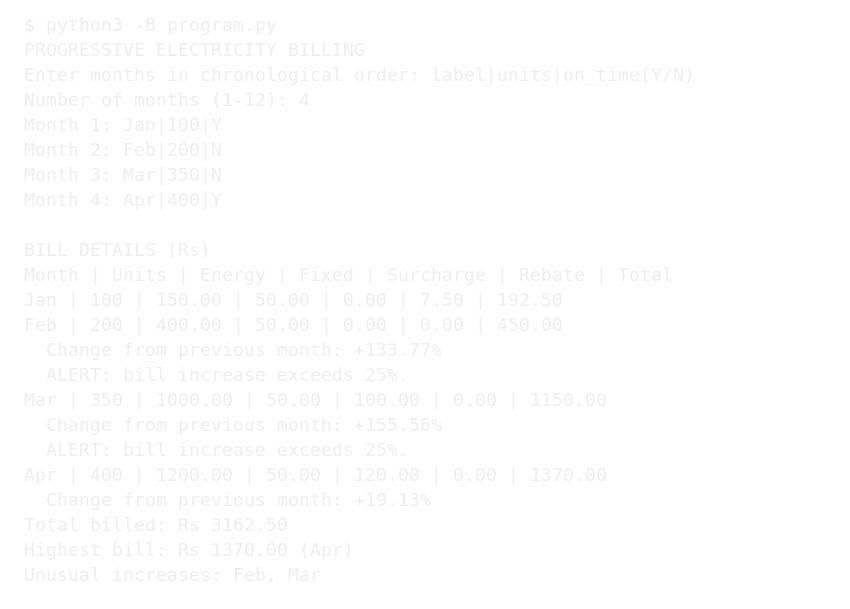

# Case Study 2: Progressive Electricity Billing

**Name:** Gottimukkala varsha

**Roll No:** 26000525

[Back to main page](../README.md)

## Problem Statement

Calculate electricity bills for several months using consumption slabs, fixed charges, a surcharge and a rebate. Compare the monthly bills and identify unusual increases.

## Objectives

- Calculate charges using different consumption slabs.
- Apply surcharge and rebate conditions.
- Compare bills and find the highest bill.

## Assumptions

- Enter 1–12 months in chronological order. Each month has a unique label of 1–12 characters and a nonnegative whole number of units.
- The first 100 units cost Rs 1.50 each, the next 100 cost Rs 2.50 each, and units above 200 cost Rs 4.00 each.
- A fixed charge of Rs 50 applies to every month, including zero consumption.
- A surcharge of 10% of the energy charge applies above 300 units.
- An on-time payment earns a 5% rebate on the energy charge when consumption is at most 100 units.
- Amounts are calculated in paise. Percentage charges are rounded half up to the nearest paise.
- An increase strictly above 25% of the previous final bill is unusual. Invalid records are entered again.

## Algorithm

1. Read and validate the number of months.
2. Read each month label, units and payment flag. Store valid records as tuples.
3. Calculate the energy charge using the three slabs.
4. Add the fixed charge and any surcharge, then subtract the rebate.
5. Compare the bill with the previous month's bill.
6. Add the bill to the total and update the highest-bill month list.
7. Display the bill details, total, highest bills and unusual increases.

## Flowchart



## Pseudocode

```text
START
Read valid month count and monthly records
Set total to 0 and previous_bill to 0
For each month:
    If units <= 100:
        energy = units * 150
    Else if units <= 200:
        energy = 15000 + (units - 100) * 250
    Else:
        energy = 40000 + (units - 200) * 400
    Set surcharge and rebate to 0
    If units > 300:
        surcharge = (energy * 10 + 50) DIV 100
    If units <= 100 and payment is on time:
        rebate = (energy * 5 + 50) DIV 100
    bill = energy + 5000 + surcharge - rebate
    If previous_bill > 0:
        Calculate percentage change
        If bill * 100 > previous_bill * 125:
            Record an unusual increase
    Update total, highest-bill ties and previous_bill
    Display bill in rupees
Display the summary
STOP
```

## Python Program

[View program.py](program.py)

Run from the repository folder:

```bash
python3 02_electricity_billing/program.py
```

Each monthly record uses `label|units|Y/N`. `Y` means payment by the due date.

## Test Cases

| Test | Input or condition | Expected Result |
|---|---|---|
| 1 | Four months shown in the sample input | Bills: Rs 192.50, 450.00, 1150.00 and 1370.00. Total: Rs 3162.50. Alerts for Feb and Mar. |
| 2 | Units 0, 100, 101, 200, 201, 300 and 301 without rebate; 1 unit with rebate | Slab boundaries are applied correctly. The 1-unit bill is Rs 51.42 after rounding. |
| 3 | 100, 120 and 120 units, all without rebate | Bills are Rs 200, 250 and 250. Exactly 25% is not flagged. Both later months share the highest bill. |
| 4 | 400 units followed by 0 units | Bills are Rs 1370 and Rs 50. The decrease is not an unusual increase. |
| 5 | Invalid count, negative units, wrong payment flag or repeated month label | Show an error and ask for the input again. |
| 6 | 100 and 101 units, both paid on time | Only the first month receives a rebate. Total is Rs 395.00. |

## Sample Input and Output

```text
4
Jan|100|Y
Feb|200|N
Mar|350|N
Apr|400|Y
```



## Conclusion

The program calculates monthly electricity bills and identifies large increases using arithmetic, conditions, loops and tuples.
