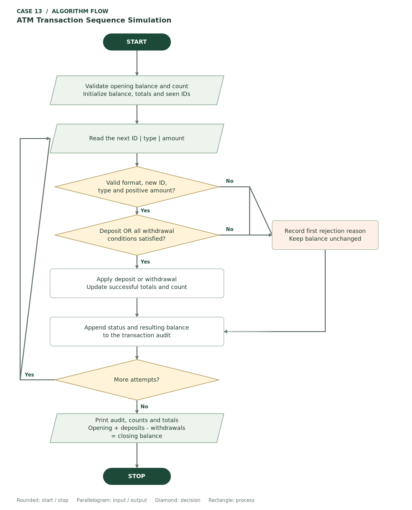
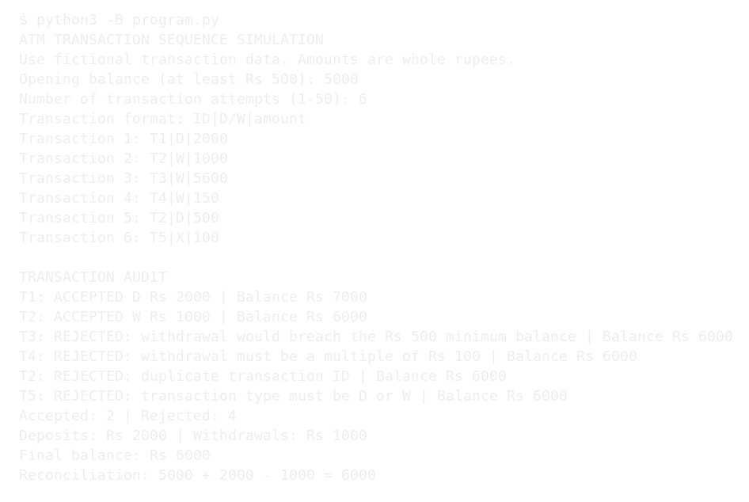

# Case Study 13: ATM Transaction Sequence Simulation

**Name:** Gottimukkala varsha

**Roll No:** 26000525

[Back to main page](../README.md)

## Problem Statement

Process deposits and withdrawals for a simulated bank account. Check transaction limits, reject invalid transactions and show the final account balance.

## Objectives

- Update the balance after each valid transaction.
- Apply withdrawal and minimum-balance rules.
- Identify duplicate transactions and prepare a summary.

## Assumptions

- Use sample account data and whole rupee amounts. The opening balance must be at least Rs 500.
- Accept 1–50 transaction attempts. Deposits must be positive.
- Withdrawals must be multiples of Rs 100, with a maximum of Rs 10000 per transaction and Rs 20000 per day.
- A withdrawal must leave at least Rs 500. Depositing money does not reset the daily withdrawal limit.
- IDs contain 1–12 ASCII letters or digits and are converted to uppercase.
- A correctly formatted record reserves a valid new ID even if its type or amount is later rejected. Repeated IDs are rejected.
- Invalid transactions count as attempts and do not change the balance. The first failed rule is reported.

## Algorithm

1. Read the opening balance and number of attempts.
2. Read a transaction ID, type and amount.
3. Check the record format, ID, duplicate status, type and amount.
4. For a withdrawal, check the denomination, transaction limit, daily limit and minimum balance.
5. Update the balance and totals only if the transaction is valid.
6. Store the status and balance for the transaction.
7. Display all transaction results and the final balance.

## Flowchart



## Pseudocode

```text
START
Read valid opening balance and attempt count
Set balance = opening balance
Set deposit_total and withdrawal_total to 0
Create empty seen-ID and result lists
For each transaction attempt:
    Read ID, type and amount
    Check format and ID; reject duplicates
    Reserve a valid new ID
    Check type and positive amount
    If withdrawal:
        Check multiple of 100
        Check amount <= 10000
        Check withdrawal_total + amount <= 20000
        Check balance - amount >= 500
    If valid deposit:
        Add amount to balance and deposit_total
    Else if valid withdrawal:
        Subtract amount from balance
        Add amount to withdrawal_total
    Else:
        Record rejection without changing the balance
    Store the transaction result
Display results and totals
Display opening balance + deposits - withdrawals = final balance
STOP
```

## Python Program

[View program.py](program.py)

```bash
python3 13_atm_transactions/program.py
```

Enter opening balance, attempt count, then records as `ID|D/W|amount`. `D` is deposit and `W` is withdrawal.

## Test Cases

| Test | Input or condition | Expected Result |
|---|---|---|
| 1 | Sample sequence starting with Rs 5000 | Two accepted and four rejected transactions. Final balance: Rs 6000. |
| 2 | Opening Rs 50000; withdrawals 10000, 10000, 100 and 10100 | First two accepted. The next exceeds the daily limit; the last exceeds the transaction limit. Final balance: Rs 30000. |
| 3 | Opening Rs 1000; withdraw 500, withdraw 100, deposit 1 | First withdrawal and deposit succeed. Final balance: Rs 501. |
| 4 | Opening balance below 500; zero or negative transaction amounts | Retry the opening balance and reject invalid amounts. |
| 5 | Malformed record, invalid ID, invalid type or reused ID | Reject the affected transactions without changing the balance. |
| 6 | Opening Rs 20500; withdraw 10000 twice, deposit 10000, then withdraw 100 | Last withdrawal fails because the daily limit is already reached. Final balance: Rs 10500. |

## Sample Input and Output

```text
5000
6
T1|D|2000
T2|W|1000
T3|W|5600
T4|W|150
T2|D|500
T5|X|100
```



## Conclusion

The program maintains a correct running balance by applying all checks before updating the account.
