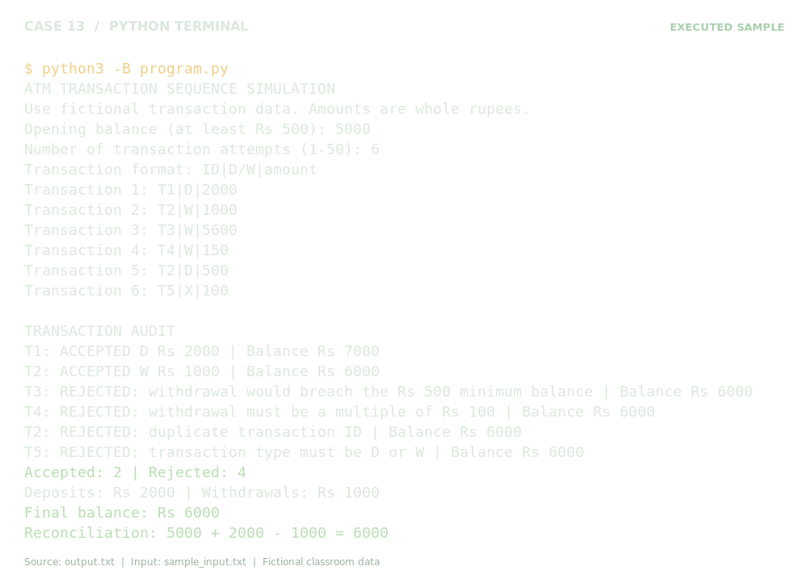

# Case 13: ATM Transaction Sequence Simulation

[← Portfolio index](../README.md) · [Complete report](../REPORT.html)

## Problem statement

Simulate a sequence of deposits and withdrawals against one account. Validate each attempted transaction, enforce withdrawal limits and a minimum balance, leave balances unchanged for rejected attempts, and produce a transaction-by-transaction audit and final reconciliation.

## Objectives

- Maintain an account balance across a sequential transaction list.
- Apply multiple validation and withdrawal conditions in a defined order.
- Reject repeated transaction identifiers without double-processing an amount.
- Reconcile the opening balance, deposits, withdrawals, and closing balance.

## Assumptions and policy

- This is a one-day classroom simulation using fictional data and whole rupees. It does not connect to a bank.
- Opening balance is at least Rs 500. Accept 1-50 attempted transactions. Deposits have no policy cap and must be positive whole rupees.
- Withdrawal amounts must be positive multiples of Rs 100, no more than Rs 10000 per transaction, and no more than Rs 20000 in successful withdrawals during the day.
- Every successful withdrawal must leave at least Rs 500. A later deposit does not reset the daily withdrawal allowance.
- A transaction ID is 1-12 ASCII letters or digits, normalized to uppercase. A well-formed row with a syntactically valid new ID reserves that ID even when its type or amount is later rejected.
- D means deposit and W means withdrawal; letter case is normalized. Invalid records count as attempts. The first failure in the program's validation order is reported, and rejected records never change the balance.

## Input and output

**Input:** Enter opening balance, number of attempts, then ID|D/W|amount for each attempt. Example: T1|W|1000.

**Output:** For every attempt: ID, acceptance or rejection reason, and unchanged or updated balance. The summary shows counts, deposit and withdrawal totals, and an arithmetic reconciliation.

## Computational thinking

- Decomposition: validate setup, identify transactions, apply account rules, and reconcile.
- Pattern recognition: every accepted transaction changes the same balance state.
- Abstraction: retain identifiers, operation types, amounts, and resulting balances.
- Algorithm design: process in input order because earlier operations affect later eligibility.

## Algorithm

1. Read a valid opening balance and transaction attempt count.
2. Initialize balance, deposit and withdrawal totals, counters, seen IDs, and audit results.
3. Read a transaction. Check its shape, ID syntax, and whether that ID has already appeared.
4. Reserve a new valid ID, then validate type and positive integer amount.
5. For withdrawals, check denomination, per-transaction limit, daily limit, and remaining balance in that order.
6. If valid, update balance and the relevant total. Otherwise record a rejection without altering money.
7. Append the ID, status, and resulting balance to the audit list.
8. After all attempts, print the audit and verify opening + deposits - withdrawals = final balance.

## Flowchart


[Scalable SVG](assets/flowchart.svg) · [Mermaid source](flowchart.mmd)

## Pseudocode

```text
START
READ opening_balance >= 500 and attempt_count in 1..50
balance <- opening_balance
seen_ids <- empty list; results <- empty list
deposited <- 0; withdrawn <- 0
accepted <- 0; rejected <- 0
FOR EACH attempt
    READ ID, type, amount
    reason <- empty
    VALIDATE record shape, ID syntax, and uniqueness
    IF new valid ID: ADD ID to seen_ids
    VALIDATE type in {D, W} and positive whole amount
    IF type = W AND no earlier error
        CHECK amount MOD 100 = 0
        CHECK amount <= 10000
        CHECK withdrawn + amount <= 20000
        CHECK balance - amount >= 500
    IF no error
        IF type = D
            balance <- balance + amount
            deposited <- deposited + amount
        ELSE
            balance <- balance - amount
            withdrawn <- withdrawn + amount
        accepted <- accepted + 1
    ELSE
        rejected <- rejected + 1
    APPEND (ID, status or first error, balance) to results
PRINT results, counts, and totals
PRINT opening_balance + deposited - withdrawn = balance
STOP
```

## Python source code

[Runnable source](program.py). From the repository root:

```bash
python3 13_atm_transactions/program.py
```

```python
print("ATM TRANSACTION SEQUENCE SIMULATION")
print("Use fictional transaction data. Amounts are whole rupees.")

opening_text = input("Opening balance (at least Rs 500): ").strip()
while not opening_text.isascii() or not opening_text.isdigit() or int(opening_text) < 500:
    print("ERROR: opening balance must be a whole number of at least 500.")
    opening_text = input("Opening balance (at least Rs 500): ").strip()
balance = int(opening_text)
opening_balance = balance

count_text = input("Number of transaction attempts (1-50): ").strip()
while not count_text.isascii() or not count_text.isdigit() or not 1 <= int(count_text) <= 50:
    print("ERROR: enter an integer from 1 to 50.")
    count_text = input("Number of transaction attempts (1-50): ").strip()
transaction_count = int(count_text)

seen_ids = []
results = []
deposited = 0
withdrawn = 0
accepted = 0
rejected = 0
print("Transaction format: ID|D/W|amount")

for attempt in range(1, transaction_count + 1):
    fields = input(f"Transaction {attempt}: ").split("|")
    transaction_id = f"row-{attempt}"
    reason = ""
    transaction_type = ""
    amount = 0
    if len(fields) != 3:
        reason = "expected ID|D/W|amount"
    else:
        transaction_id, transaction_type, amount_text = fields
        transaction_id = transaction_id.strip().upper()
        transaction_type = transaction_type.strip().upper()
        amount_text = amount_text.strip()
        if not 1 <= len(transaction_id) <= 12 or not transaction_id.isascii() or not transaction_id.isalnum():
            reason = "ID must contain 1-12 ASCII letters or digits"
        elif transaction_id in seen_ids:
            reason = "duplicate transaction ID"
        else:
            seen_ids.append(transaction_id)
            if transaction_type not in ("D", "W"):
                reason = "transaction type must be D or W"
            elif not amount_text.isascii() or not amount_text.isdigit() or int(amount_text) == 0:
                reason = "amount must be a positive whole number"
            else:
                amount = int(amount_text)
                if transaction_type == "W":
                    if amount % 100 != 0:
                        reason = "withdrawal must be a multiple of Rs 100"
                    elif amount > 10000:
                        reason = "per-transaction withdrawal limit is Rs 10000"
                    elif withdrawn + amount > 20000:
                        reason = "daily withdrawal limit is Rs 20000"
                    elif balance - amount < 500:
                        reason = "withdrawal would breach the Rs 500 minimum balance"
    if reason == "":
        if transaction_type == "D":
            balance += amount
            deposited += amount
        else:
            balance -= amount
            withdrawn += amount
        accepted += 1
        results.append((transaction_id, f"ACCEPTED {transaction_type} Rs {amount}", balance))
    else:
        rejected += 1
        results.append((transaction_id, f"REJECTED: {reason}", balance))

print("\nTRANSACTION AUDIT")
for transaction_id, status, ending_balance in results:
    print(f"{transaction_id}: {status} | Balance Rs {ending_balance}")
print(f"Accepted: {accepted} | Rejected: {rejected}")
print(f"Deposits: Rs {deposited} | Withdrawals: Rs {withdrawn}")
print(f"Final balance: Rs {balance}")
print(f"Reconciliation: {opening_balance} + {deposited} - {withdrawn} = {balance}")
```

## Test cases

Six automated fixtures cover normal, boundary, and validation behavior. Full stdin and assertions are in [tests.json](tests.json).

| Test | Type | Expected result | Actual result |
|---|---|---|---|
| `01_normal` | Normal | Two accepted, four rejected. Deposits 2000, withdrawals 1000, final balance 6000. | PASS · [raw stdout](test_outputs/01_normal.txt) |
| `02_withdrawal_limits` | Boundary | First two withdrawals succeed. Daily and per-transaction limit breaches fail. Balance 30000. | PASS · [raw stdout](test_outputs/02_withdrawal_limits.txt) |
| `03_minimum_balance` | Boundary | Withdrawal to 500 succeeds; further withdrawal fails; deposit of 1 succeeds. Final 501. | PASS · [raw stdout](test_outputs/03_minimum_balance.txt) |
| `04_invalid_values` | Validation | Opening balance and count are retried. Both transactions fail without changing balance. | PASS · [raw stdout](test_outputs/04_invalid_values.txt) |
| `05_ids_and_format` | Validation | All four rows rejected. U1 is reserved by its first well-formed occurrence. | PASS · [raw stdout](test_outputs/05_ids_and_format.txt) |
| `06_deposit_does_not_reset_limit` | Boundary | Three accepted, one rejected. Withdrawal total stays 20000 and final balance is 10500. | PASS · [raw stdout](test_outputs/06_deposit_does_not_reset_limit.txt) |

## Output screenshot

The image is a rendered capture of the actual pseudo-terminal execution of test `01_normal`. Typed sample inputs are visible in the transcript. Every sample is fictional.



[Full terminal transcript](output.txt) · [Exact sample input](sample_input.txt) · [Scalable output image](assets/output.svg)

```text
$ python3 -B program.py
ATM TRANSACTION SEQUENCE SIMULATION
Use fictional transaction data. Amounts are whole rupees.
Opening balance (at least Rs 500): 5000
Number of transaction attempts (1-50): 6
Transaction format: ID|D/W|amount
Transaction 1: T1|D|2000
Transaction 2: T2|W|1000
Transaction 3: T3|W|5600
Transaction 4: T4|W|150
Transaction 5: T2|D|500
Transaction 6: T5|X|100

TRANSACTION AUDIT
T1: ACCEPTED D Rs 2000 | Balance Rs 7000
T2: ACCEPTED W Rs 1000 | Balance Rs 6000
T3: REJECTED: withdrawal would breach the Rs 500 minimum balance | Balance Rs 6000
T4: REJECTED: withdrawal must be a multiple of Rs 100 | Balance Rs 6000
T2: REJECTED: duplicate transaction ID | Balance Rs 6000
T5: REJECTED: transaction type must be D or W | Balance Rs 6000
Accepted: 2 | Rejected: 4
Deposits: Rs 2000 | Withdrawals: Rs 1000
Final balance: Rs 6000
Reconciliation: 5000 + 2000 - 1000 = 6000
```

## Conclusion

The program demonstrates how ordered validation protects a changing state. Tests confirm exact withdrawal limits, the minimum-balance boundary, rejected-ID reuse, and the fact that deposits do not replenish the daily withdrawal allowance.
