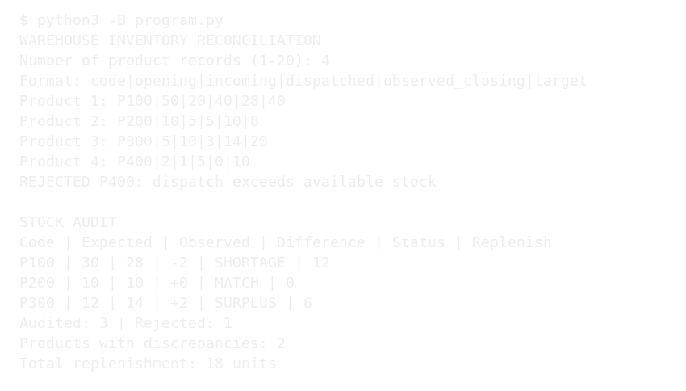

# Case Study 14: Warehouse Inventory Reconciliation

**Name:** Gottimukkala varsha

**Roll No:** 26000525

[Back to main page](../README.md)

## Problem Statement

Compare stock records with physically observed closing stock. Find shortages or surpluses and calculate the quantities needed to reach the target stock.

## Objectives

- Calculate expected closing stock.
- Identify differences between expected and observed stock.
- Determine replenishment requirements.

## Assumptions

- Accept 1–20 product-record attempts. All quantities are nonnegative whole units.
- Product codes contain 1–12 ASCII letters or digits and are converted to uppercase.
- The first correctly formatted record with a valid product code reserves that code. Repeated codes are rejected even if an earlier record failed a later check.
- Expected stock = opening stock + incoming stock − dispatched stock.
- Dispatch above available stock is invalid. An observed stock difference is reported as a discrepancy.
- Difference = observed stock − expected stock. A negative value is a shortage; a positive value is a surplus.
- Replenishment is based on observed stock: target − observed if the target is higher, otherwise zero. Invalid records are excluded from totals.

## Algorithm

1. Read the number of product records.
2. Read and validate the six fields for each product.
3. Reject duplicate codes, invalid quantities and impossible dispatches.
4. Store the valid product tuples.
5. Calculate expected stock and its difference from observed stock.
6. Classify the difference and calculate replenishment.
7. Display the product results and summary.

## Flowchart


## Pseudocode

```text
START
Read valid record count
Create product and seen-code lists
For each record:
    Read code, opening, incoming, dispatched, observed and target
    Validate the fields and reserve a valid new code
    If quantities are invalid or dispatch exceeds opening + incoming:
        Reject the record
    Otherwise store the product tuple
For each accepted product:
    expected = opening + incoming - dispatched
    difference = observed - expected
    If difference < 0: status = SHORTAGE
    Else if difference > 0: status = SURPLUS
    Else: status = MATCH
    replenish = 0
    If observed < target:
        replenish = target - observed
    Update totals and display the result
Display discrepancy, rejection and replenishment totals
STOP
```

## Python Program

[View program.py](program.py)

```bash
python3 14_warehouse_reconciliation/program.py
```

Record format: `code|opening|incoming|dispatched|observed_closing|target`.

## Test Cases

| Test | Input or condition | Expected Result |
|---|---|---|
| 1 | Four products shown in the sample input | P100 has a shortage of 2; P200 matches; P300 has a surplus of 2; P400 is rejected. Replenishment total: 18 units. |
| 2 | Empty stock; another product dispatches all 20 available units with target 5 | Both records match their observed closing stock of zero. The second product needs 5 units. |
| 3 | Expected 10, observed 8, target 9; expected 10, observed 15, target 12 | First product needs 1 unit. Second product needs none. Both have discrepancies. |
| 4 | Repeated product code or dispatch above available stock | Reject the affected record. |
| 5 | Malformed record, negative quantity, decimal quantity or non-ASCII numeric input | Reject the records and exclude them from totals. |
| 6 | Count entered as 0, then 21, then 1; valid product with closing 0 and target 4 | Retry invalid counts and report replenishment of 4 units. |

## Sample Input and Output

```text
4
P100|50|20|40|28|40
P200|10|5|5|10|8
P300|5|10|3|14|20
P400|2|1|5|0|10
```



## Conclusion

The program detects stock differences and calculates replenishment using the actual observed stock.
