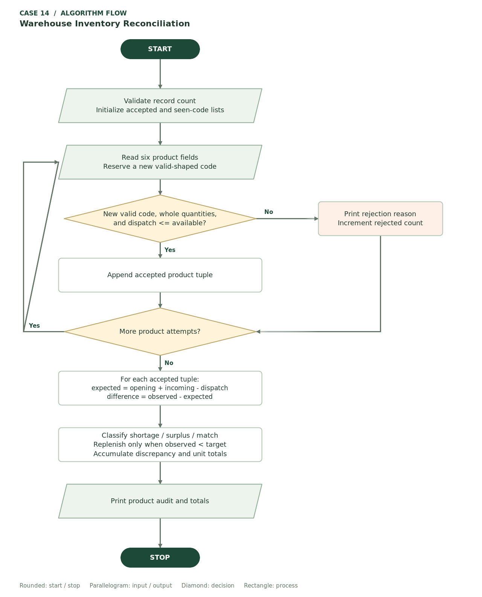
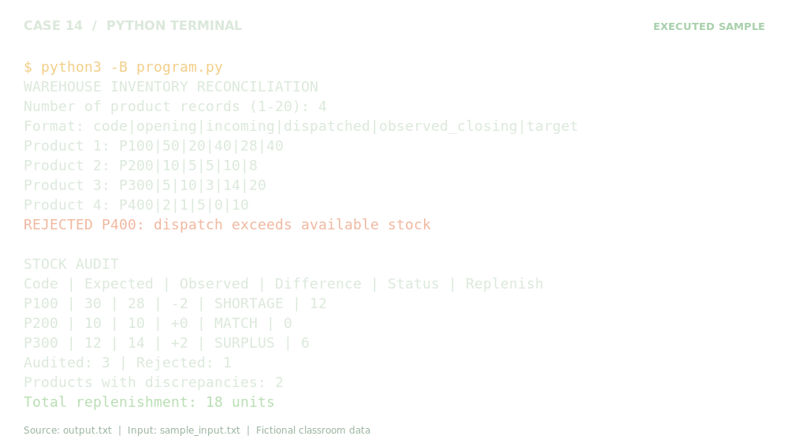

# Case 14: Warehouse Inventory Reconciliation

[← Portfolio index](../README.md) · [Complete report](../REPORT.html)

## Problem statement

Compare opening stock, receipts, dispatches, and physically observed closing stock for multiple products. Identify shortages and surpluses, reject impossible stock movement, and calculate each product's replenishment quantity against its target.

## Objectives

- Reconcile theoretical and physical stock using a stock-balance equation.
- Distinguish invalid movement from an auditable physical discrepancy.
- Calculate replenishment from the observed stock level.
- Store and unpack multi-field product tuples and summarize audit counts.

## Assumptions and policy

- Accept 1-20 attempted product records. All quantities are nonnegative whole units of the same product; cross-product replenishment totals count units only.
- Product codes contain 1-12 ASCII letters or digits and normalize to uppercase. The first correctly shaped record with a valid code reserves that code, even if later numeric validation fails.
- Expected closing stock = opening + incoming - dispatched. Dispatch greater than opening + incoming is impossible under this model and is rejected.
- Difference = observed closing - expected closing. A negative difference is a shortage; a positive one is a surplus.
- Observed stock may differ from the records and remains auditable even if it exceeds expected stock. Replenishment is target - observed when observed is below target, otherwise zero.
- Invalid records count as attempts and contribute to neither stock calculations nor replenishment totals.

## Input and output

**Input:** Enter the record count, then code|opening|incoming|dispatched|observed_closing|target. Example: P100|50|20|40|28|40.

**Output:** Rejected-record reasons, expected and observed quantities, signed discrepancies, status, per-product replenishment, and audit totals.

## Computational thinking

- Decomposition: check record validity, calculate expected stock, compare, and replenish.
- Pattern recognition: each product follows the same inventory-balance equation.
- Abstraction: physical and book quantities are separate fields; neither overwrites the other.
- Algorithm design: exclude invalid records before calculating the accepted-record summary.

## Algorithm

1. Read a valid record count and initialize products, seen codes, and rejection count.
2. Read six fields per attempted record and validate the product code and uniqueness.
3. Validate five nonnegative integer quantities.
4. Reject dispatch above available stock; otherwise store the product tuple.
5. For each stored tuple, calculate expected stock and observed - expected.
6. Classify each difference as shortage, surplus, or match.
7. Calculate replenishment from observed stock and add it to the total.
8. Print the itemized audit, discrepancy count, rejected count, and replenishment total.

## Flowchart



[Scalable SVG](assets/flowchart.svg) · [Mermaid source](flowchart.mmd)

## Pseudocode

```text
START
READ record_count in 1..20
products <- empty list; seen_codes <- empty list
FOR EACH attempted record
    READ code, opening, incoming, dispatched, observed, target
    VALIDATE six fields and a new valid normalized code
    RESERVE each new syntactically valid code
    VALIDATE all quantities as nonnegative integers
    IF dispatched > opening + incoming: REJECT
    IF valid: APPEND the six-field product tuple
    ELSE: PRINT reason and increment rejected count
discrepancies <- 0; total_replenishment <- 0
FOR EACH product tuple
    expected <- opening + incoming - dispatched
    difference <- observed - expected
    IF difference < 0: status <- SHORTAGE
    ELSE IF difference > 0: status <- SURPLUS
    ELSE: status <- MATCH
    IF difference != 0: discrepancies <- discrepancies + 1
    replenish <- 0
    IF observed < target: replenish <- target - observed
    total_replenishment <- total_replenishment + replenish
    PRINT code, expected, observed, difference, status, replenish
PRINT audit and replenishment totals
STOP
```

## Python source code

[Runnable source](program.py). From the repository root:

```bash
python3 14_warehouse_reconciliation/program.py
```

```python
print("WAREHOUSE INVENTORY RECONCILIATION")
count_text = input("Number of product records (1-20): ").strip()
while not count_text.isascii() or not count_text.isdigit() or not 1 <= int(count_text) <= 20:
    print("ERROR: enter an integer from 1 to 20.")
    count_text = input("Number of product records (1-20): ").strip()
record_count = int(count_text)
print("Format: code|opening|incoming|dispatched|observed_closing|target")

products = []
seen_codes = []
invalid_records = 0
for record_number in range(1, record_count + 1):
    fields = input(f"Product {record_number}: ").split("|")
    reason = ""
    code = f"row-{record_number}"
    numbers = []
    if len(fields) != 6:
        reason = "expected six fields"
    else:
        code = fields[0].strip().upper()
        if not 1 <= len(code) <= 12 or not code.isascii() or not code.isalnum():
            reason = "code must contain 1-12 ASCII letters or digits"
        elif code in seen_codes:
            reason = "duplicate product code"
        else:
            seen_codes.append(code)
            for field in fields[1:]:
                number_text = field.strip()
                if not number_text.isascii() or not number_text.isdigit():
                    reason = "quantities must be nonnegative whole numbers"
                else:
                    numbers.append(int(number_text))
            if reason == "":
                opening, incoming, dispatched, observed, target = numbers
                if dispatched > opening + incoming:
                    reason = "dispatch exceeds available stock"
                else:
                    products.append((code, opening, incoming, dispatched, observed, target))
    if reason != "":
        invalid_records += 1
        print(f"REJECTED {code}: {reason}")

print("\nSTOCK AUDIT")
print("Code | Expected | Observed | Difference | Status | Replenish")
discrepancies = 0
total_replenishment = 0
for code, opening, incoming, dispatched, observed, target in products:
    expected = opening + incoming - dispatched
    difference = observed - expected
    if difference < 0:
        status = "SHORTAGE"
        discrepancies += 1
    elif difference > 0:
        status = "SURPLUS"
        discrepancies += 1
    else:
        status = "MATCH"
    replenish = 0
    if observed < target:
        replenish = target - observed
    total_replenishment += replenish
    print(f"{code} | {expected} | {observed} | {difference:+d} | {status} | {replenish}")
print(f"Audited: {len(products)} | Rejected: {invalid_records}")
print(f"Products with discrepancies: {discrepancies}")
print(f"Total replenishment: {total_replenishment} units")
```

## Test cases

Six automated fixtures cover normal, boundary, and validation behavior. Full stdin and assertions are in [tests.json](tests.json).

| Test | Type | Expected result | Actual result |
|---|---|---|---|
| `01_normal` | Normal | P100 shortage 2, replenish 12; P200 matched; P300 surplus 2, replenish 6; P400 rejected. | PASS · [raw stdout](test_outputs/01_normal.txt) |
| `02_zero_and_full_dispatch` | Boundary | Both records match. P2 needs five units. | PASS · [raw stdout](test_outputs/02_zero_and_full_dispatch.txt) |
| `03_observed_stock_basis` | Boundary | P1 needs 1 unit despite an expected stock of 10. P2 needs none. | PASS · [raw stdout](test_outputs/03_observed_stock_basis.txt) |
| `04_duplicates_and_impossible_movement` | Validation | Only the first P1 record is audited. No replenishment. | PASS · [raw stdout](test_outputs/04_duplicates_and_impossible_movement.txt) |
| `05_no_valid_records` | Validation | Four rejected; no audited products, discrepancies, or replenishment. | PASS · [raw stdout](test_outputs/05_no_valid_records.txt) |
| `06_count_retry` | Validation | One valid product after count correction. Expected stock 0, replenishment 4. | PASS · [raw stdout](test_outputs/06_count_retry.txt) |

## Output screenshot

The image is a rendered capture of the actual pseudo-terminal execution of test `01_normal`. Typed sample inputs are visible in the transcript. Every sample is fictional.



[Full terminal transcript](output.txt) · [Exact sample input](sample_input.txt) · [Scalable output image](assets/output.svg)

```text
$ python3 -B program.py
WAREHOUSE INVENTORY RECONCILIATION
Number of product records (1-20): 4
Format: code|opening|incoming|dispatched|observed_closing|target
Product 1: P100|50|20|40|28|40
Product 2: P200|10|5|5|10|8
Product 3: P300|5|10|3|14|20
Product 4: P400|2|1|5|0|10
REJECTED P400: dispatch exceeds available stock

STOCK AUDIT
Code | Expected | Observed | Difference | Status | Replenish
P100 | 30 | 28 | -2 | SHORTAGE | 12
P200 | 10 | 10 | +0 | MATCH | 0
P300 | 12 | 14 | +2 | SURPLUS | 6
Audited: 3 | Rejected: 1
Products with discrepancies: 2
Total replenishment: 18 units
```

## Conclusion

The audit keeps stock-record discrepancies separate from purchasing needs. Tests show that replenishment uses the physical count, that complete dispatch is valid, and that impossible movement and duplicate codes cannot distort totals.
