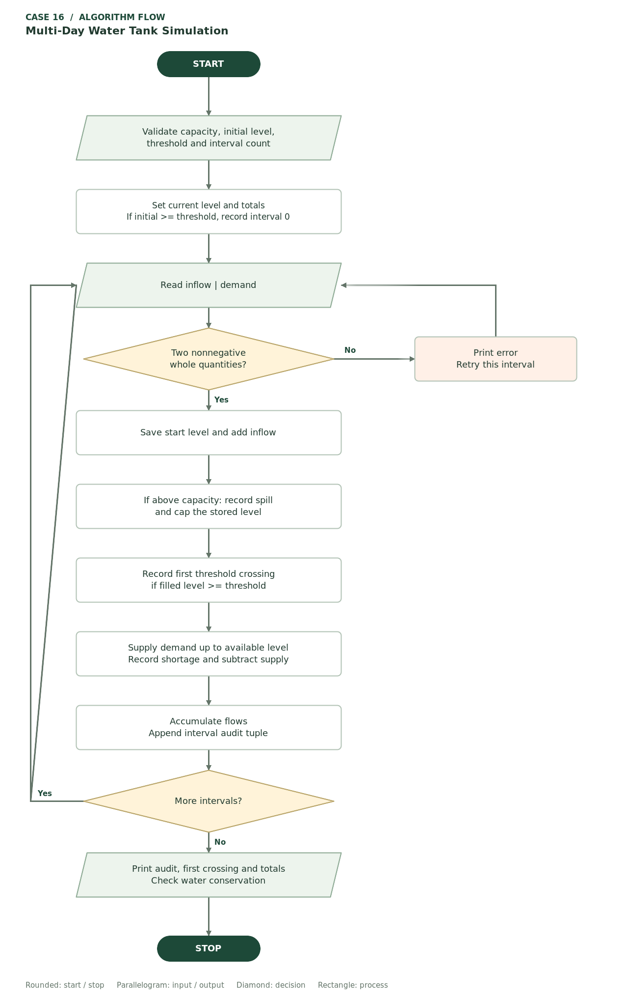
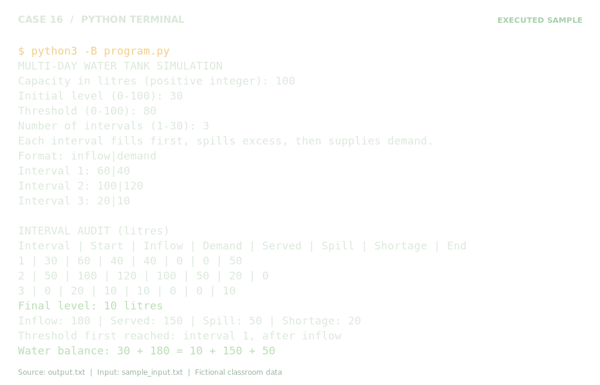

# Case 16: Multi-Day Water Tank Simulation

[← Portfolio index](../README.md) · [Complete report](../REPORT.html)

## Problem statement

Simulate a tank across a sequence of intervals with changing inflow and demand. Keep the stored level within capacity, measure overflow and unmet demand, identify the first interval in which a threshold is reached, and verify the water balance.

## Objectives

- Update a bounded state across multiple time intervals.
- Distinguish demand, delivered water, spilled water, and shortage.
- Detect threshold crossings before an interval's later withdrawal.
- Check conservation using initial water, inflow, final water, supply, and spill.

## Assumptions and policy

- All values are whole litres. Capacity is positive; initial level and threshold lie between zero and capacity, inclusive. Accept 1-30 valid intervals.
- Within each interval, all inflow occurs first, excess immediately spills, and demand is then supplied from the remaining stored water. There is no simultaneous-flow model.
- Delivered water is the smaller of demand and stored water after filling. Unmet demand is demand minus delivered water.
- The threshold means a stored level greater than or equal to the target. Check the initial level and the level after filling, before demand. A later fall below the threshold does not erase the first crossing.
- Interval 0 denotes an initially met threshold. A zero threshold is therefore reached initially.
- Malformed inflow/demand records are retried and do not advance time. There are no unrecorded leaks or evaporation.

## Input and output

**Input:** Enter capacity, initial level, threshold, interval count, then inflow|demand for each interval. Example: 60|40.

**Output:** A table of start level, inflow, demand, delivered quantity, spill, shortage, and end level; aggregate flows; first threshold interval; and a conservation equation.

## Computational thinking

- Decomposition: fill, spill, test the threshold, supply demand, and summarize.
- Pattern recognition: the same state transition repeats each interval.
- Abstraction: represent water as a scalar level and retain an interval tuple for the audit.
- Algorithm design: enforce operation order so overflow and shortage can both occur in one interval.

## Algorithm

1. Validate capacity, initial water, threshold, and interval count.
2. Set the current level to initial water and record interval 0 if the threshold is already met.
3. Read and validate inflow and demand, retrying malformed records.
4. Save the starting level, add inflow, calculate any spill, and cap the stored level at capacity.
5. If no earlier crossing exists and the filled level meets the threshold, record the current interval.
6. Deliver demand up to the available level, calculate shortage, and subtract delivered water.
7. Accumulate totals and append the interval audit tuple.
8. After all intervals, print the audit and confirm initial + inflow = final + delivered + spill.

## Flowchart



[Scalable SVG](assets/flowchart.svg) · [Mermaid source](flowchart.mmd)

## Pseudocode

```text
START
READ valid capacity, initial, threshold, interval_count
level <- initial; first_crossing <- NOT_REACHED
IF initial >= threshold: first_crossing <- 0
INITIALIZE totals and interval records
WHILE completed intervals < interval_count
    READ inflow and demand
    IF either is not a nonnegative integer: PRINT error; RETRY
    start_level <- level
    level <- level + inflow
    spill <- 0
    IF level > capacity
        spill <- level - capacity
        level <- capacity
    IF first_crossing is NOT_REACHED AND level >= threshold
        first_crossing <- current interval number
    served <- demand; shortage <- 0
    IF demand > level
        served <- level
        shortage <- demand - level
    level <- level - served
    UPDATE flow totals
    APPEND (start, inflow, demand, served, spill, shortage, level)
PRINT interval audit and totals
PRINT initial crossing, first interval, or never
PRINT initial + total_inflow = level + total_served + total_spill
STOP
```

## Python source code

[Runnable source](program.py). From the repository root:

```bash
python3 16_water_tank/program.py
```

```python
print("MULTI-DAY WATER TANK SIMULATION")
capacity_text = input("Capacity in litres (positive integer): ").strip()
while not capacity_text.isascii() or not capacity_text.isdigit() or int(capacity_text) == 0:
    print("ERROR: capacity must be a positive whole number.")
    capacity_text = input("Capacity in litres (positive integer): ").strip()
capacity = int(capacity_text)

initial_text = input(f"Initial level (0-{capacity}): ").strip()
while not initial_text.isascii() or not initial_text.isdigit() or not 0 <= int(initial_text) <= capacity:
    print("ERROR: initial level must be within tank capacity.")
    initial_text = input(f"Initial level (0-{capacity}): ").strip()
initial = int(initial_text)
level = initial

threshold_text = input(f"Threshold (0-{capacity}): ").strip()
while not threshold_text.isascii() or not threshold_text.isdigit() or not 0 <= int(threshold_text) <= capacity:
    print("ERROR: threshold must be within tank capacity.")
    threshold_text = input(f"Threshold (0-{capacity}): ").strip()
threshold = int(threshold_text)

count_text = input("Number of intervals (1-30): ").strip()
while not count_text.isascii() or not count_text.isdigit() or not 1 <= int(count_text) <= 30:
    print("ERROR: enter an integer from 1 to 30.")
    count_text = input("Number of intervals (1-30): ").strip()
interval_count = int(count_text)

records = []
total_inflow = 0
total_served = 0
total_spill = 0
total_shortage = 0
first_threshold_interval = -1
if level >= threshold:
    first_threshold_interval = 0
print("Each interval fills first, spills excess, then supplies demand.")
print("Format: inflow|demand")

while len(records) < interval_count:
    fields = input(f"Interval {len(records) + 1}: ").split("|")
    valid = len(fields) == 2
    if valid:
        for field in fields:
            number_text = field.strip()
            if not number_text.isascii() or not number_text.isdigit():
                valid = False
    if not valid:
        print("ERROR: enter two nonnegative whole numbers: inflow|demand.")
        continue
    inflow = int(fields[0].strip())
    demand = int(fields[1].strip())
    starting_level = level
    level += inflow
    spill = 0
    if level > capacity:
        spill = level - capacity
        level = capacity
    if first_threshold_interval == -1 and level >= threshold:
        first_threshold_interval = len(records) + 1
    served = demand
    shortage = 0
    if demand > level:
        served = level
        shortage = demand - level
    level -= served
    total_inflow += inflow
    total_served += served
    total_spill += spill
    total_shortage += shortage
    records.append((starting_level, inflow, demand, served, spill, shortage, level))

print("\nINTERVAL AUDIT (litres)")
print("Interval | Start | Inflow | Demand | Served | Spill | Shortage | End")
for record_index in range(len(records)):
    starting_level, inflow, demand, served, spill, shortage, ending_level = records[record_index]
    print(f"{record_index + 1} | {starting_level} | {inflow} | {demand} | {served} | {spill} | {shortage} | {ending_level}")
print(f"Final level: {level} litres")
print(f"Inflow: {total_inflow} | Served: {total_served} | Spill: {total_spill} | Shortage: {total_shortage}")
if first_threshold_interval == 0:
    print("Threshold first reached: initially (interval 0)")
elif first_threshold_interval == -1:
    print("Threshold first reached: never")
else:
    print(f"Threshold first reached: interval {first_threshold_interval}, after inflow")
print(f"Water balance: {initial} + {total_inflow} = {level} + {total_served} + {total_spill}")
```

## Test cases

Six automated fixtures cover normal, boundary, and validation behavior. Full stdin and assertions are in [tests.json](tests.json).

| Test | Type | Expected result | Actual result |
|---|---|---|---|
| `01_normal` | Normal | End levels 50, 0, 10. Spill 50, shortage 20; threshold first reached in interval 1. | PASS · [raw stdout](test_outputs/01_normal.txt) |
| `02_initial_threshold` | Boundary | Threshold reached initially even though the end level is 50. | PASS · [raw stdout](test_outputs/02_initial_threshold.txt) |
| `03_threshold_never_reached` | Boundary | 124 litres pass through the tank, but its level never reaches 100. | PASS · [raw stdout](test_outputs/03_threshold_never_reached.txt) |
| `04_overflow_before_demand` | Boundary | Spill 9, served 10, shortage 10, final level 0. Threshold reached after inflow. | PASS · [raw stdout](test_outputs/04_overflow_before_demand.txt) |
| `05_zero_flows` | Boundary | No movement; threshold 0 is reached initially. | PASS · [raw stdout](test_outputs/05_zero_flows.txt) |
| `06_invalid_inputs` | Validation | Only the valid interval is simulated, leaving 7 litres; threshold never reached. | PASS · [raw stdout](test_outputs/06_invalid_inputs.txt) |

## Output screenshot

The image is a rendered capture of the actual pseudo-terminal execution of test `01_normal`. Typed sample inputs are visible in the transcript. Every sample is fictional.



[Full terminal transcript](output.txt) · [Exact sample input](sample_input.txt) · [Scalable output image](assets/output.svg)

```text
$ python3 -B program.py
MULTI-DAY WATER TANK SIMULATION
Capacity in litres (positive integer): 100
Initial level (0-100): 30
Threshold (0-100): 80
Number of intervals (1-30): 3
Each interval fills first, spills excess, then supplies demand.
Format: inflow|demand
Interval 1: 60|40
Interval 2: 100|120
Interval 3: 20|10

INTERVAL AUDIT (litres)
Interval | Start | Inflow | Demand | Served | Spill | Shortage | End
1 | 30 | 60 | 40 | 40 | 0 | 0 | 50
2 | 50 | 100 | 120 | 100 | 50 | 20 | 0
3 | 0 | 20 | 10 | 10 | 0 | 0 | 10
Final level: 10 litres
Inflow: 180 | Served: 150 | Spill: 50 | Shortage: 20
Threshold first reached: interval 1, after inflow
Water balance: 30 + 180 = 10 + 150 + 50
```

## Conclusion

The simulation accounts for every litre and makes the order of events explicit. Tests cover initial and zero thresholds, a never-reached threshold, and an interval that spills water before later suffering a shortage.
