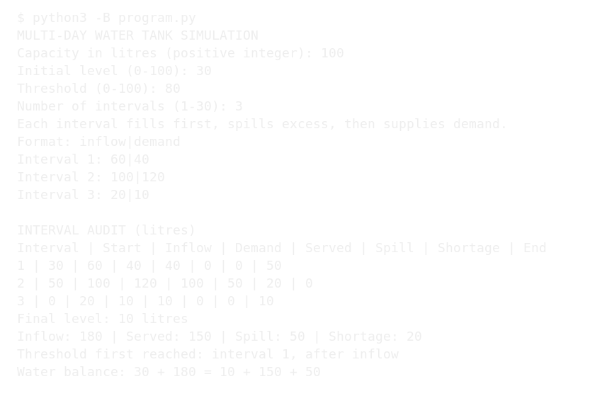

# Case Study 16: Multi-Day Water Tank Simulation

**Name:** Gottimukkala varsha

**Roll No:** 26000525

[Back to main page](../README.md)

## Problem Statement

Simulate the water level in a tank over several intervals. Calculate overflow, shortages and the first interval in which the tank reaches a given threshold.

## Objectives

- Update the tank level after inflow and demand.
- Calculate overflow and unmet demand.
- Identify the first threshold crossing and check the water balance.

## Assumptions

- Quantities are whole litres. Capacity must be positive. Initial level and threshold must be between zero and capacity.
- Accept 1–30 valid intervals.
- In each interval, inflow occurs first. Water above capacity spills immediately. Demand is supplied after that.
- Supplied water cannot exceed the available level. The remaining demand is the shortage.
- The threshold is reached when the level is greater than or equal to it. Check the initial level and the level after inflow, before supplying demand.
- An initially reached threshold is recorded as interval 0. Invalid interval inputs are entered again.
- There are no leaks or other water losses apart from the recorded spill.

## Algorithm

1. Read and validate capacity, initial level, threshold and interval count.
2. Check whether the initial level already meets the threshold.
3. Read the inflow and demand for an interval.
4. Add inflow and remove any overflow above capacity.
5. Record the interval if this is the first threshold crossing.
6. Supply the available water, calculate the shortage and update the level.
7. Store the interval results and add to the totals.
8. Display the results and check initial + inflow = final level + supplied water + spill.

## Flowchart


## Pseudocode

```text
START
Read valid capacity, initial level, threshold and interval count
level = initial level
If level >= threshold: record interval 0
For each valid interval:
    Read nonnegative inflow and demand
    Save starting level
    level = level + inflow
    spill = 0
    If level > capacity:
        spill = level - capacity
        level = capacity
    If threshold has not been reached and level >= threshold:
        Record this interval
    served = demand
    shortage = 0
    If demand > level:
        served = level
        shortage = demand - level
    level = level - served
    Store the interval and update totals
Display interval results, threshold result and water balance
STOP
```

## Python Program

[View program.py](program.py)

```bash
python3 16_water_tank/program.py
```

Enter capacity, initial level, threshold, interval count, then `inflow|demand` for each interval.

## Test Cases

| Test | Input or condition | Expected Result |
|---|---|---|
| 1 | Sample input: capacity 100, initial 30, threshold 80, three intervals | Final level 10; spill 50; shortage 20. Threshold reached in interval 1. |
| 2 | Capacity 100, initial 80, threshold 80; inflow 0, demand 30 | Threshold reached initially. Final level is 50. |
| 3 | Capacity 100, initial 0, threshold 100; inflow/demand pairs 25/25 and 99/99 | Threshold is never reached even though total inflow is 124. |
| 4 | Capacity 10, initial 9, threshold 10; inflow 10, demand 20 | Spill 9, supplied 10, shortage 10, final level 0. |
| 5 | Initial level 0, threshold 0, zero inflow and demand | Threshold reached at interval 0; all flow totals are zero. |
| 6 | Invalid capacity, out-of-range levels, wrong count or negative inflow | Show errors and retry the affected inputs. |

## Sample Input and Output

```text
100
30
80
3
60|40
100|120
20|10
```



## Conclusion

The simulation keeps the water level within the tank capacity and accounts for supplied water, overflow and shortages.
