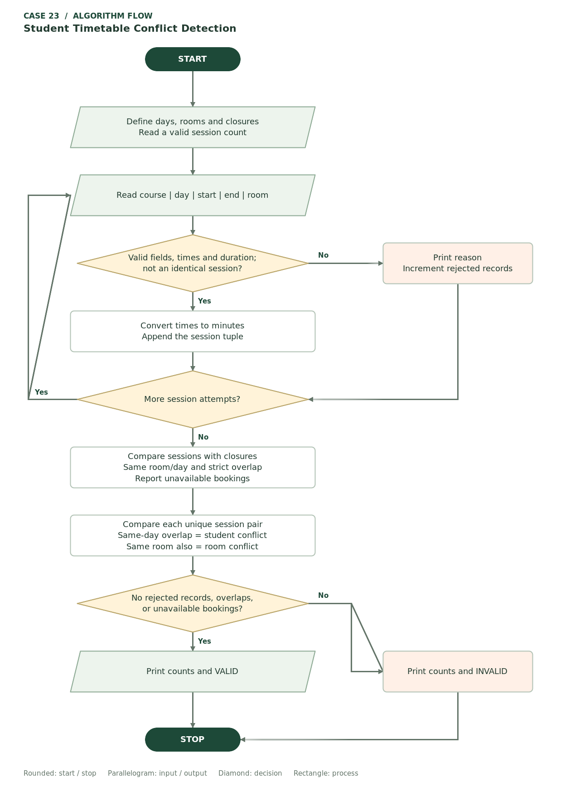
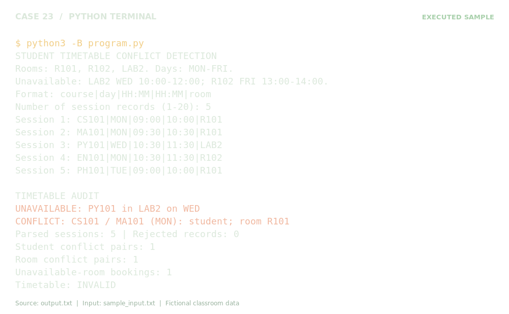

# Case 23: Student Timetable Conflict Detection

[← Portfolio index](../README.md) · [Complete report](../REPORT.html)

## Problem statement

Validate a proposed timetable for one student. Parse course sessions from strings into tuples, detect overlapping sessions and simultaneous room bookings, identify sessions scheduled during room closures, and report whether the timetable is valid.

## Objectives

- Parse and validate strict 24-hour time strings using basic string operations.
- Represent sessions and room closures as tuples with minute-based time intervals.
- Use nested loops to compare unique session pairs.
- Distinguish student conflicts, room conflicts, malformed records, and blocked bookings.

## Assumptions and policy

- Accept 1-20 attempted session records for one student's timetable. Valid days are MON-FRI and valid rooms are R101, R102, and LAB2.
- Assumed closures: LAB2 on WED from 10:00 to 12:00, and R102 on FRI from 13:00 to 14:00.
- Course codes contain 1-12 ASCII letters or digits. Course, day, and room text normalize to uppercase.
- Times use exactly HH:MM, from 00:00 through 23:59. Each session ends after it starts on the same day. Overnight sessions and 24:00 are outside this model.
- Intervals are half-open: [start, end). A session may end exactly when another begins or a closure starts. Overlap requires a_start < b_end and b_start < a_end.
- Every same-day overlapping pair is a student conflict; it is additionally a room conflict if both rooms match. Compare each pair once.
- Identical session tuples are rejected. A course may have distinct sessions. Syntactically valid sessions during closures remain in the pairwise audit so every problem is reported.
- Any rejected record, student conflict, or blocked booking makes the complete timetable invalid.

## Input and output

**Input:** Enter the number of attempts and then course|day|HH:MM|HH:MM|room. Example: CS101|MON|09:00|10:00|R101.

**Output:** Rejected-record reasons, unavailable-room bookings, named conflict pairs, separate conflict counts, and a final VALID or INVALID verdict.

## Computational thinking

- Decomposition: parse sessions, check closures, compare pairs, and combine findings.
- Pattern recognition: the same strict overlap test applies to sessions and closures.
- Abstraction: replace clock strings with minutes after midnight.
- Algorithm design: compare index pairs with the second index greater than the first to avoid double-counting.

## Algorithm

1. Define valid days, rooms, and the supplied classroom closure tuples.
2. Read a valid session count and validate each five-field record.
3. Convert both valid HH:MM strings into hour * 60 + minute; require start < end.
4. Reject duplicate session tuples; store other valid tuples.
5. Compare each stored session with every closure for its room and day, reporting overlaps.
6. Compare each unique pair of stored sessions on the same day using the strict overlap inequalities.
7. Count every overlapping pair as a student conflict and, when rooms match, as a room conflict.
8. Print counts and declare the timetable valid only when no rejection, overlap, or blocked booking exists.

## Flowchart



[Scalable SVG](assets/flowchart.svg) · [Mermaid source](flowchart.mmd)

## Pseudocode

```text
START
DEFINE valid days, rooms, and closure tuples
READ session_count in 1..20
sessions <- empty list; rejected <- 0
FOR EACH attempted record
    READ course, day, start_text, end_text, room
    VALIDATE fields, course code, day, and room
    FOR EACH of the two time strings
        CHECK exactly HH:MM, ASCII digits, hour 0..23, minute 0..59
        CONVERT to hour * 60 + minute
    CHECK start < end and tuple not already in sessions
    IF valid: APPEND (course, day, start, end, room)
    ELSE: PRINT reason; increment rejected
FOR EACH session AND EACH room closure
    IF same room and day AND start < closure_end AND end > closure_start
        REPORT unavailable booking
FOR first_index FROM 0 TO number_of_sessions - 1
    FOR second_index FROM first_index + 1 TO number_of_sessions - 1
        IF same day AND first_start < second_end AND second_start < first_end
            REPORT student conflict
            IF rooms match: ALSO COUNT room conflict
PRINT counts
IF no rejected records, student conflicts, or blocked bookings
    PRINT VALID
ELSE: PRINT INVALID
STOP
```

## Python source code

[Runnable source](program.py). From the repository root:

```bash
python3 23_timetable_conflicts/program.py
```

```python
print("STUDENT TIMETABLE CONFLICT DETECTION")
days = ("MON", "TUE", "WED", "THU", "FRI")
rooms = ("R101", "R102", "LAB2")
unavailable = [("LAB2", "WED", 600, 720), ("R102", "FRI", 780, 840)]
print("Rooms: R101, R102, LAB2. Days: MON-FRI.")
print("Unavailable: LAB2 WED 10:00-12:00; R102 FRI 13:00-14:00.")
print("Format: course|day|HH:MM|HH:MM|room")

count_text = input("Number of session records (1-20): ").strip()
while not count_text.isascii() or not count_text.isdigit() or not 1 <= int(count_text) <= 20:
    print("ERROR: enter an integer from 1 to 20.")
    count_text = input("Number of session records (1-20): ").strip()
session_count = int(count_text)
sessions = []
rejected = 0

for record_number in range(1, session_count + 1):
    fields = input(f"Session {record_number}: ").split("|")
    reason = ""
    if len(fields) != 5:
        reason = "expected five fields"
    else:
        course, day, start_text, end_text, room = fields
        course = course.strip().upper()
        day = day.strip().upper()
        room = room.strip().upper()
        times = []
        if not 1 <= len(course) <= 12 or not course.isascii() or not course.isalnum():
            reason = "course must contain 1-12 ASCII letters or digits"
        elif day not in days or room not in rooms:
            reason = "unknown day or room"
        else:
            for time_text in (start_text.strip(), end_text.strip()):
                valid_time = len(time_text) == 5 and time_text[2] == ":"
                if valid_time:
                    hour_text = time_text[:2]
                    minute_text = time_text[3:]
                    valid_time = hour_text.isascii() and hour_text.isdigit() and minute_text.isascii() and minute_text.isdigit()
                    if valid_time:
                        hour = int(hour_text)
                        minute = int(minute_text)
                        valid_time = 0 <= hour <= 23 and 0 <= minute <= 59
                if valid_time:
                    times.append(hour * 60 + minute)
                else:
                    reason = "times must use valid 24-hour HH:MM format"
            if reason == "":
                start, end = times
                session = (course, day, start, end, room)
                if start >= end:
                    reason = "end time must be later than start time on the same day"
                elif session in sessions:
                    reason = "duplicate session"
                else:
                    sessions.append(session)
    if reason != "":
        rejected += 1
        print(f"REJECTED row {record_number}: {reason}")

print("\nTIMETABLE AUDIT")
blocked_bookings = 0
student_conflicts = 0
room_conflicts = 0
for course, day, start, end, room in sessions:
    for blocked_room, blocked_day, blocked_start, blocked_end in unavailable:
        if room == blocked_room and day == blocked_day and start < blocked_end and end > blocked_start:
            blocked_bookings += 1
            print(f"UNAVAILABLE: {course} in {room} on {day}")

for first_index in range(len(sessions)):
    first_course, first_day, first_start, first_end, first_room = sessions[first_index]
    for second_index in range(first_index + 1, len(sessions)):
        second_course, second_day, second_start, second_end, second_room = sessions[second_index]
        if first_day == second_day and first_start < second_end and second_start < first_end:
            student_conflicts += 1
            detail = "student"
            if first_room == second_room:
                room_conflicts += 1
                detail += f"; room {first_room}"
            print(f"CONFLICT: {first_course} / {second_course} ({first_day}): {detail}")

print(f"Parsed sessions: {len(sessions)} | Rejected records: {rejected}")
print(f"Student conflict pairs: {student_conflicts}")
print(f"Room conflict pairs: {room_conflicts}")
print(f"Unavailable-room bookings: {blocked_bookings}")
if rejected == 0 and student_conflicts == 0 and blocked_bookings == 0:
    print("Timetable: VALID")
else:
    print("Timetable: INVALID")
```

## Test cases

Six automated fixtures cover normal, boundary, and validation behavior. Full stdin and assertions are in [tests.json](tests.json).

| Test | Type | Expected result | Actual result |
|---|---|---|---|
| `01_normal` | Normal | One student conflict pair, one room conflict pair, one unavailable booking. Invalid timetable. | PASS · [raw stdout](test_outputs/01_normal.txt) |
| `02_adjacent_sessions` | Boundary | No conflicts or blocked bookings. Valid timetable. | PASS · [raw stdout](test_outputs/02_adjacent_sessions.txt) |
| `03_different_rooms` | Boundary | One student conflict but no room conflict. | PASS · [raw stdout](test_outputs/03_different_rooms.txt) |
| `04_closure_edges` | Boundary | All four sessions are valid; half-open intervals do not overlap at endpoints. | PASS · [raw stdout](test_outputs/04_closure_edges.txt) |
| `05_invalid_sessions` | Validation | All six records rejected; no comparisons attempted; timetable invalid. | PASS · [raw stdout](test_outputs/05_invalid_sessions.txt) |
| `06_duplicate_session` | Validation | One duplicate rejected; two parsed sessions produce exactly one conflict pair. | PASS · [raw stdout](test_outputs/06_duplicate_session.txt) |

## Output screenshot

The image is a rendered capture of the actual pseudo-terminal execution of test `01_normal`. Typed sample inputs are visible in the transcript. Every sample is fictional.



[Full terminal transcript](output.txt) · [Exact sample input](sample_input.txt) · [Scalable output image](assets/output.svg)

```text
$ python3 -B program.py
STUDENT TIMETABLE CONFLICT DETECTION
Rooms: R101, R102, LAB2. Days: MON-FRI.
Unavailable: LAB2 WED 10:00-12:00; R102 FRI 13:00-14:00.
Format: course|day|HH:MM|HH:MM|room
Number of session records (1-20): 5
Session 1: CS101|MON|09:00|10:00|R101
Session 2: MA101|MON|09:30|10:30|R101
Session 3: PY101|WED|10:30|11:30|LAB2
Session 4: EN101|MON|10:30|11:30|R102
Session 5: PH101|TUE|09:00|10:00|R101

TIMETABLE AUDIT
UNAVAILABLE: PY101 in LAB2 on WED
CONFLICT: CS101 / MA101 (MON): student; room R101
Parsed sessions: 5 | Rejected records: 0
Student conflict pairs: 1
Room conflict pairs: 1
Unavailable-room bookings: 1
Timetable: INVALID
```

## Conclusion

Converting times to minutes makes the conflict rule precise and reusable. Tests prove that adjacent sessions and closure endpoints are allowed, that different rooms do not remove a student's conflict, and that duplicate records do not multiply pair counts.
