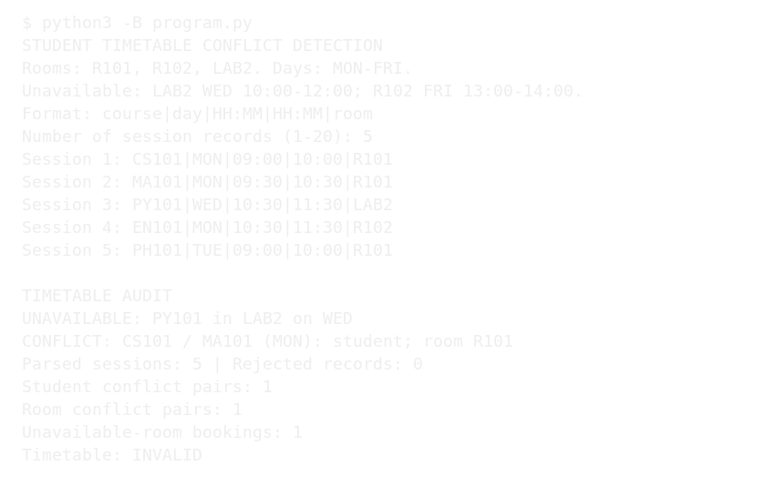

# Case Study 23: Student Timetable Conflict Detection

**Name:** Gottimukkala varsha

**Roll No:** 26000525

[Back to main page](../README.md)

## Problem Statement

Check a student's timetable for overlapping sessions, room conflicts and bookings during room closures.

## Objectives

- Validate course, room and time details.
- Compare time intervals using tuples and nested loops.
- Report conflicts and decide whether the timetable is valid.

## Assumptions

- Accept 1–20 session-record attempts for one student. Days are MON–FRI; rooms are R101, R102 and LAB2.
- LAB2 is unavailable on WED from 10:00 to 12:00. R102 is unavailable on FRI from 13:00 to 14:00.
- Course codes contain 1–12 ASCII letters or digits. Course, day and room text are converted to uppercase.
- Times use exactly `HH:MM`, from 00:00 to 23:59. The end must be later than the start on the same day.
- A session ending exactly when another starts does not overlap. The overlap rule is `first_start < second_end` and `second_start < first_end`.
- Any overlapping pair is a student conflict. It is also a room conflict if both rooms match.
- Identical session tuples are rejected. A course may have different sessions. Validly formatted bookings during closures are still checked for other conflicts.
- Any rejected record, overlap or unavailable-room booking makes the timetable invalid.

## Algorithm

1. Define valid days, rooms and room closures.
2. Read the session count and each session record.
3. Validate the fields and convert times to minutes after midnight.
4. Reject invalid or duplicate sessions; store valid tuples.
5. Check each session against the room closures.
6. Compare every unique pair of sessions for a same-day overlap.
7. Count student and room conflicts separately.
8. Display all problems and the final timetable status.

## Flowchart


## Pseudocode

```text
START
Define valid days, rooms and closures
Read a valid session count
For each session attempt:
    Read course, day, start, end and room
    Validate the fields and time format
    Convert times to hour * 60 + minute
    Check start < end and reject an identical session
    Store the tuple if valid; otherwise report rejection
For each stored session:
    Compare with closures for the same room and day
    Report any overlap
For each unique pair of stored sessions:
    If same day and the intervals overlap:
        Count and report a student conflict
        If rooms match: also count a room conflict
Display counts
If there are no rejections, overlaps or blocked bookings:
    Display VALID
Else:
    Display INVALID
STOP
```

## Python Program

[View program.py](program.py)

```bash
python3 23_timetable_conflicts/program.py
```

Record format: `course|day|HH:MM|HH:MM|room`.

## Test Cases

| Test | Input or condition | Expected Result |
|---|---|---|
| 1 | Five sessions shown in the sample input | One student conflict, one room conflict and one unavailable booking. Timetable is invalid. |
| 2 | Same-room sessions 09:00–10:00 and 10:00–11:00; another session on a different day | No conflict. |
| 3 | Same-day overlapping sessions in different rooms | One student conflict but no room conflict. |
| 4 | Sessions ending at a closure's start or beginning at its end | Allowed; no unavailable-room booking. |
| 5 | `9:00`, `24:00`, `09:60`, equal start/end, unknown day or missing fields | Reject the affected records. |
| 6 | Two identical sessions followed by another overlapping session | Reject one duplicate and count the remaining conflict pair once. |

## Sample Input and Output

```text
5
CS101|MON|09:00|10:00|R101
MA101|MON|09:30|10:30|R101
PY101|WED|10:30|11:30|LAB2
EN101|MON|10:30|11:30|R102
PH101|TUE|09:00|10:00|R101
```



## Conclusion

The program detects timetable clashes by converting times to minutes and comparing intervals without counting the same pair twice.
