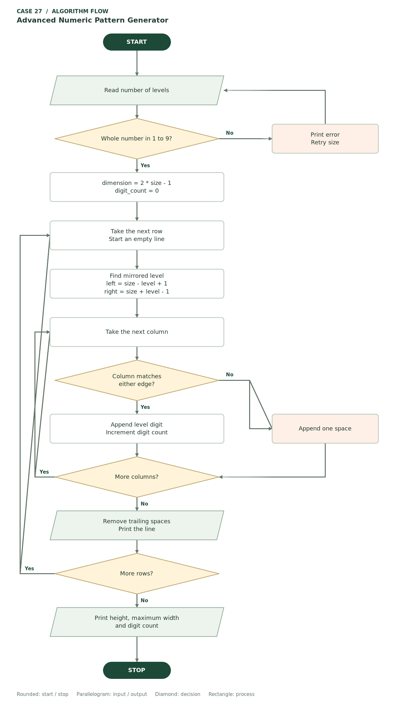
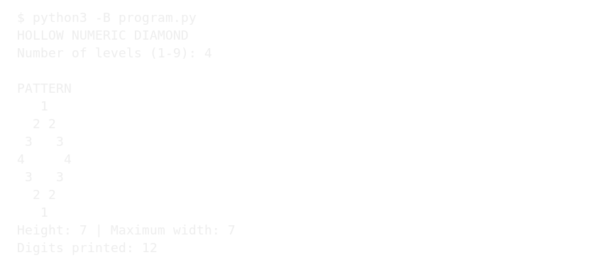

# Case Study 27: Advanced Numeric Pattern Generator

**Name:** Gottimukkala varsha

**Roll No:** 26000525

[Back to main page](../README.md)

## Problem Statement

Generate a hollow numeric diamond for a user-given size. Validate the size and align both halves of the pattern.

## Objectives

- Generate a pattern using nested loops.
- Use row and column positions to print the boundary.
- Handle the smallest and largest allowed sizes.

## Assumptions

- The selected pattern is a hollow numeric diamond.
- The size must be an integer from 1 to 9 so every level fits in one character.
- Height and maximum width are both `2 * size - 1`.
- The number printed on each boundary is the row's level. The inside is filled with spaces.
- Leading spaces are kept and trailing spaces are removed.
- At size 1, the left and right boundaries are the same cell and only one digit is printed.
- Invalid sizes are entered again.

## Algorithm

1. Read and validate the size.
2. Calculate the dimension and initialize the digit count.
3. For each row, find its level in the upper or lower half.
4. Calculate the left and right boundary positions.
5. Scan the columns and append the level digit at either boundary; append spaces elsewhere.
6. Remove trailing spaces and print the row.
7. Display height, maximum width and digit count.

## Flowchart



## Pseudocode

```text
START
Read size until it is an integer from 1 to 9
dimension = 2 * size - 1
digit_count = 0
For row from 1 to dimension:
    If row <= size:
        level = row
    Else:
        level = 2 * size - row
    left_edge = size - level + 1
    right_edge = size + level - 1
    line = empty string
    For column from 1 to dimension:
        If column matches left_edge or right_edge:
            Append level to line
            Increase digit_count by 1
        Else:
            Append one space
    Print line after removing trailing spaces
Display dimension and digit_count
STOP
```

## Python Program

[View program.py](program.py)

```bash
python3 27_numeric_diamond/program.py
```

Enter one integer representing the number of levels.

## Test Cases

| Test | Input | Expected Result |
|---|---|---|
| 1 | 4 | Seven rows, maximum width 7 and 12 printed digits. |
| 2 | 1 | One row containing a single `1`. |
| 3 | 2 | Three rows with levels 1, 2, 1 and four printed digits. |
| 4 | 9 | Seventeen rows, maximum width 17 and 32 printed digits. |
| 5 | 0, 10, a negative number, letters or a non-ASCII digit | Show an error and request the size again. |
| 6 | 5 | Nine symmetric rows and 16 printed digits. |

## Sample Input and Output

```text
4
```

The pattern for this input is:

```text
   1
  2 2
 3   3
4     4
 3   3
  2 2
   1
```



## Conclusion

The program creates a symmetric hollow pattern using nested loops, string construction and calculated boundary positions.
