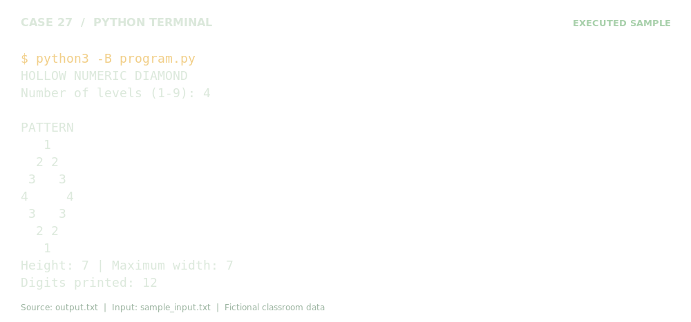

# Case 27: Advanced Numeric Pattern Generator

[← Portfolio index](../README.md) · [Complete report](../REPORT.html)

## Problem statement

Generate a hollow, symmetric numeric diamond for a user-specified number of levels. Validate the dimension, preserve alignment, and handle the single-level boundary without printing a duplicate digit.

## Objectives

- Use nested loops to map rows and columns to a pattern.
- Derive the matching upper and lower halves from one level formula.
- Print only boundary digits while preserving the hollow interior.
- Validate dimensions and report the generated height, width, and digit count.

## Assumptions and policy

- The chosen variant of the brief is a hollow numeric diamond. A level is represented by its own digit.
- Accept an integer size from 1 to 9 so every printed value occupies one character.
- The output has 2 * size - 1 rows and the same maximum width. Spaces between the two edge digits remain blank.
- Rows are shown in a monospaced font. Leading spaces are meaningful; trailing spaces are removed.
- Invalid sizes are retried. At size 1, the left and right edges coincide and print one digit.

## Input and output

**Input:** One integer size in 1-9. Example: 4.

**Output:** A hollow numeric diamond followed by its height, maximum width, and the number of printed digits.

## Computational thinking

- Decomposition: validate the size, determine each row's level, determine boundaries, and print.
- Pattern recognition: lower-half levels mirror the upper half.
- Abstraction: a cell needs only its row, column, and the two edge positions.
- Algorithm design: one nested row/column loop handles both halves and the size-one case.

## Algorithm

1. Read and validate size between 1 and 9.
2. Set dimension = 2 * size - 1 and digit count = 0.
3. For each row from 1 through dimension, use level = row in the upper half and level = 2 * size - row in the lower half.
4. Calculate left_edge = size - level + 1 and right_edge = size + level - 1.
5. Scan all columns. Append the level digit when the column matches either edge; otherwise append one space.
6. Increment the digit count only once for each printed cell, including coincident edges.
7. Remove trailing spaces and print the completed row.
8. Print the height, maximum width, and digit count.

## Flowchart


[Scalable SVG](assets/flowchart.svg) · [Mermaid source](flowchart.mmd)

## Pseudocode

```text
START
READ valid size in 1..9
dimension <- 2 * size - 1
digit_count <- 0
FOR row FROM 1 TO dimension
    IF row <= size: level <- row
    ELSE: level <- 2 * size - row
    left_edge <- size - level + 1
    right_edge <- size + level - 1
    line <- empty string
    FOR column FROM 1 TO dimension
        IF column = left_edge OR column = right_edge
            APPEND text(level) to line
            digit_count <- digit_count + 1
        ELSE
            APPEND one space to line
    REMOVE trailing spaces from line
    PRINT line
PRINT dimension as height and maximum width
PRINT digit_count
STOP
```

## Python source code

[Runnable source](program.py). From the repository root:

```bash
python3 27_numeric_diamond/program.py
```

```python
print("HOLLOW NUMERIC DIAMOND")
size_text = input("Number of levels (1-9): ").strip()
while not size_text.isascii() or not size_text.isdigit() or not 1 <= int(size_text) <= 9:
    print("ERROR: enter an integer from 1 to 9.")
    size_text = input("Number of levels (1-9): ").strip()
size = int(size_text)
dimension = 2 * size - 1
digit_count = 0
print("\nPATTERN")

for row_number in range(1, dimension + 1):
    level = row_number
    if row_number > size:
        level = 2 * size - row_number
    left_edge = size - level + 1
    right_edge = size + level - 1
    line = ""
    for column_number in range(1, dimension + 1):
        if column_number == left_edge or column_number == right_edge:
            line += str(level)
            digit_count += 1
        else:
            line += " "
    print(line.rstrip())

print(f"Height: {dimension} | Maximum width: {dimension}")
print(f"Digits printed: {digit_count}")
```

## Test cases

Six automated fixtures cover normal, boundary, and validation behavior. Full stdin and assertions are in [tests.json](tests.json).

| Test | Type | Expected result | Actual result |
|---|---|---|---|
| `01_normal` | Normal | Seven rows with edge values 1, 2, 3, 4, 3, 2, 1; 12 digits. | PASS · [raw stdout](test_outputs/01_normal.txt) |
| `02_minimum_size` | Boundary | Exactly one digit, one row, one column. | PASS · [raw stdout](test_outputs/02_minimum_size.txt) |
| `03_size_two` | Boundary | Rows are ' 1', '2 2', ' 1'; four digits. | PASS · [raw stdout](test_outputs/03_size_two.txt) |
| `04_maximum_size` | Boundary | 17 rows, maximum width 17, 32 digits; middle row has two 9s separated by 15 spaces. | PASS · [raw stdout](test_outputs/04_maximum_size.txt) |
| `05_invalid_sizes` | Validation | Invalid sizes are retried, then a five-row diamond with eight digits is printed. | PASS · [raw stdout](test_outputs/05_invalid_sizes.txt) |
| `06_symmetry` | Normal | The upper and lower halves mirror each other; height 9 and 16 digits. | PASS · [raw stdout](test_outputs/06_symmetry.txt) |

## Output screenshot

The image is a rendered capture of the actual pseudo-terminal execution of test `01_normal`. Typed sample inputs are visible in the transcript. Every sample is fictional.



[Full terminal transcript](output.txt) · [Exact sample input](sample_input.txt) · [Scalable output image](assets/output.svg)

```text
$ python3 -B program.py
HOLLOW NUMERIC DIAMOND
Number of levels (1-9): 4

PATTERN
   1
  2 2
 3   3
4     4
 3   3
  2 2
   1
Height: 7 | Maximum width: 7
Digits printed: 12
```

## Conclusion

A single mirrored level formula generates the complete pattern with basic loops and strings. Tests include both size limits, invalid dimensions, exact row spacing, and the special one-digit output for size 1.
