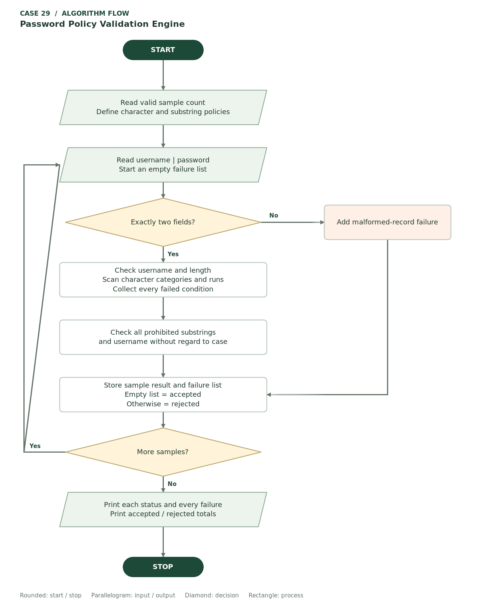
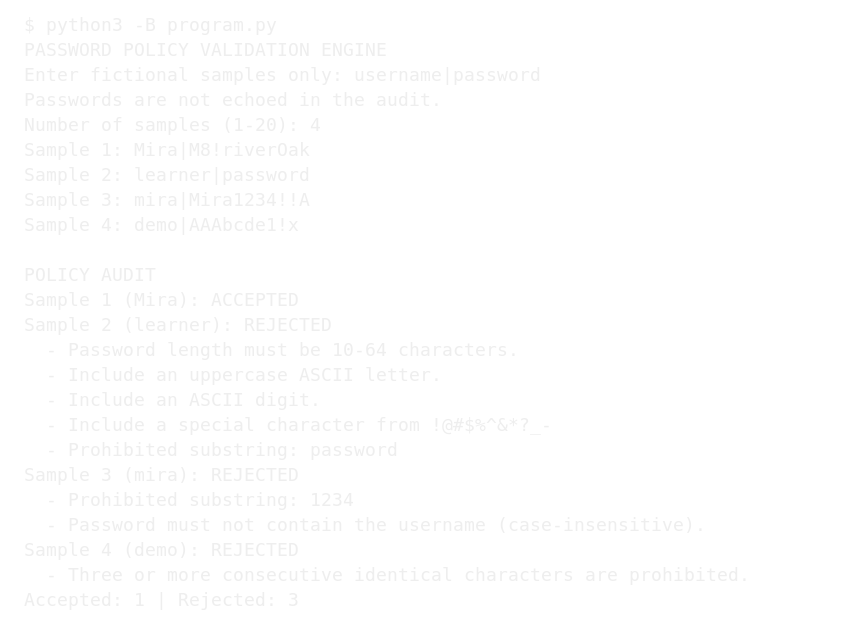

# Case Study 29: Password Policy Validation Engine

**Name:** Gottimukkala varsha

**Roll No:** 26000525

[Back to main page](../README.md)

## Problem Statement

Check sample passwords against length, character, repetition and prohibited-substring rules. Explain each failed condition.

## Objectives

- Check character groups using string operations and loops.
- Detect repeated characters and prohibited text.
- Report all failed rules for each sample.

## Assumptions

- Use fictional passwords for this exercise. Accept 1–20 samples in `username|password` format with exactly one separator.
- Usernames must contain 3–20 ASCII letters or digits.
- Passwords must contain 10–64 characters, including an uppercase letter, a lowercase letter, a digit and a special character.
- Allowed special characters are `!@#$%^&*?_-`. Spaces and other characters are not allowed. Password spaces are preserved for validation.
- Three or more consecutive identical characters are not allowed. This repetition check is case-sensitive.
- The substrings `password`, `admin`, `qwerty` and `1234` are prohibited, ignoring letter case. A valid username must not appear in the password, ignoring case.
- All applicable failures are reported for a correctly formatted record. Full passwords are not printed in the result summary, although normal terminal input is visible.

## Algorithm

1. Read and validate the sample count.
2. Split each record into username and password.
3. Check the username and password length.
4. Scan each character to identify character groups, disallowed characters and repeated runs.
5. Add a reason for every failed condition.
6. Check the prohibited substrings and username.
7. Accept the sample only if no failure was found.
8. Display each result, its reasons and the total counts.

## Flowchart



## Pseudocode

```text
START
Read valid sample count
For each sample:
    Create an empty failure list
    Read username and password
    If record format is wrong:
        Add a format error
    Else:
        Check username and password length
        Initialize character-group flags and run length
        For each password character:
            Identify its group or mark it as invalid
            Update the consecutive-character run length
            If run length >= 3: record a repetition failure
        Add failures for missing groups or invalid characters
        Check every prohibited substring without regard to case
        Check whether the valid username appears in the password
    If failure list is empty:
        Count the sample as accepted
    Else:
        Count it as rejected
    Store the sample result
Display results, all failure reasons and totals
STOP
```

## Python Program

[View program.py](program.py)

```bash
python3 29_password_validation/program.py
```

Enter the sample count and then `username|password` records.

## Test Cases

| Test | Input or condition | Expected Result |
|---|---|---|
| 1 | Four fictional samples shown below | One accepted and three rejected. Display all failed conditions. |
| 2 | Username `demo`; passwords `A1!bcdefgh` and `A1!bcdefg` | Accept the 10-character password; reject the 9-character password. |
| 3 | Username `demo`; passwords `AA1!bcdefg` and `AAA1!bcdef` | Two repeated characters are allowed; three are rejected. |
| 4 | A password containing mixed-case `admin`, `qwerty`, `password` or the username | Reject the sample regardless of letter case. |
| 5 | Missing separator, short username, password space or non-ASCII character | Report the applicable format or character errors. |
| 6 | Otherwise valid passwords of 64 and 65 characters | Accept 64 characters and reject 65. |

## Sample Input and Output

```text
4
Mira|M8!riverOak
learner|password
mira|Mira1234!!A
demo|AAAbcde1!x
```



## Conclusion

The program checks several string conditions and gives a clear list of reasons whenever a sample fails the stated policy.
