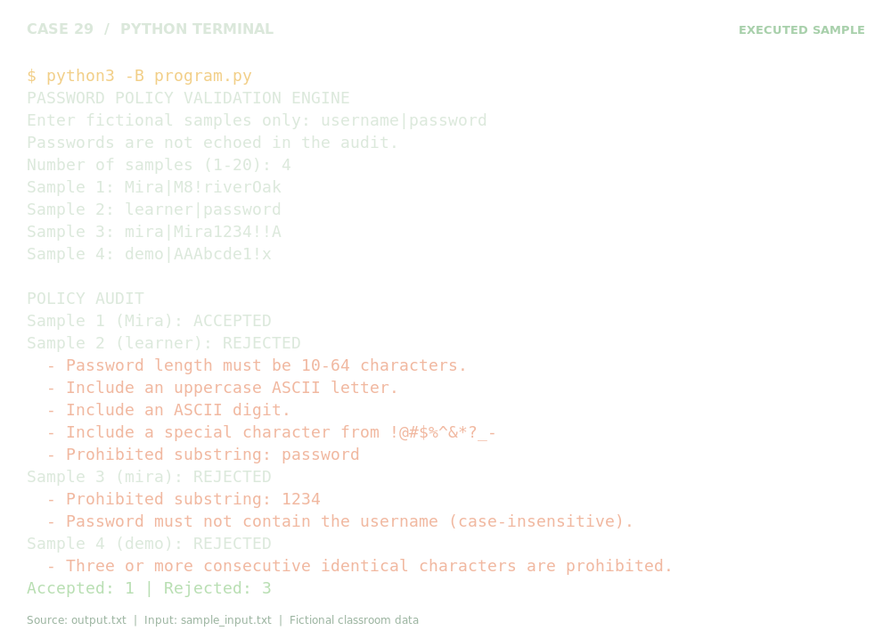

# Case 29: Password Policy Validation Engine

[← Portfolio index](../README.md) · [Complete report](../REPORT.html)

## Problem statement

Evaluate fictional password samples against a declared length, character-category, repetition, and prohibited-substring policy. Report every failed condition for each sample, without repeating the full password in the result audit.

## Objectives

- Scan strings using loops and character comparisons.
- Collect every policy failure instead of stopping after the first one.
- Detect consecutive character runs and case-insensitive substrings.
- Separate input-format errors from password-policy failures.

## Assumptions and policy

- This is a string-processing classroom policy, not a production authentication system. Use fictional sample strings. Normal input() entry is visible in a terminal; only the audit avoids printing full passwords.
- Accept 1-20 samples in username|password form, with exactly one separator. Usernames contain 3-20 ASCII letters or digits.
- Password length is 10-64 characters. Require at least one ASCII uppercase letter, lowercase letter, digit, and one special character from !@#$%^&*?_-.
- Only those character groups are allowed. Password whitespace is preserved and rejected; it is not silently stripped. The pipe character is not an allowed password character.
- Three or more identical consecutive characters are prohibited. Repetition matching is case-sensitive.
- The substrings password, admin, qwerty, and 1234 are forbidden regardless of case. A valid username must not appear in the password regardless of case.
- Malformed records are rejected as samples. For a correctly shaped record, report all independently testable failures. An invalid username does not prevent evaluation of the other password rules.

## Input and output

**Input:** Enter the sample count, then username|password. Example fictional input: Mira|M8!riverOak.

**Output:** Sample number and username, ACCEPTED or REJECTED status, every failed condition, and accepted/rejected totals.

## Computational thinking

- Decomposition: validate record shape, scan categories, detect runs, and inspect substrings.
- Pattern recognition: one scan can collect category flags and run lengths together.
- Abstraction: represent compliance through booleans and a list of failure explanations.
- Algorithm design: accept only when the full failure list remains empty.

## Algorithm

1. Read a valid sample count and initialize result and summary lists/counters.
2. Split each sample on the separator; reject malformed records.
3. Check username syntax and password length.
4. Scan every password character to set category flags, flag disallowed characters, and detect runs of at least three identical characters.
5. Append a separate failure for each missing category, invalid-character condition, and prohibited run.
6. Compare a lowercase copy with every prohibited substring and the valid username.
7. Store the sample number, username, and complete failure list.
8. Print ACCEPTED for empty failure lists; otherwise print REJECTED and all reasons. Print totals.

## Flowchart


[Scalable SVG](assets/flowchart.svg) · [Mermaid source](flowchart.mmd)

## Pseudocode

```text
START
READ sample_count in 1..20
DEFINE allowed special characters and prohibited substrings
FOR EACH sample
    failures <- empty list
    READ username|password without trimming password
    IF record does not contain exactly two fields
        ADD malformed-record failure
    ELSE
        CHECK username syntax and password length
        INITIALIZE category flags, run length, and previous character
        FOR EACH character IN password
            SET its ASCII category flag OR flag invalid character
            IF character = previous: increment run length
            ELSE: run length <- 1
            IF run length >= 3: flag prohibited repetition
            previous <- character
        ADD a failure for every missing category
        ADD invalid-character and repetition failures when applicable
        FOR EACH prohibited substring
            IF it appears in lowercase(password): ADD its failure
        IF username is valid AND lowercase(username) appears in lowercase(password)
            ADD username-substring failure
    STORE (sample number, username, failures)
    UPDATE accepted or rejected count
PRINT every sample status and every failure
PRINT totals
STOP
```

## Python source code

[Runnable source](program.py). From the repository root:

```bash
python3 29_password_validation/program.py
```

```python
print("PASSWORD POLICY VALIDATION ENGINE")
print("Enter fictional samples only: username|password")
print("Passwords are not echoed in the audit.")
count_text = input("Number of samples (1-20): ").strip()
while not count_text.isascii() or not count_text.isdigit() or not 1 <= int(count_text) <= 20:
    print("ERROR: enter an integer from 1 to 20.")
    count_text = input("Number of samples (1-20): ").strip()
sample_count = int(count_text)

special_characters = "!@#$%^&*?_-"
prohibited = ("password", "admin", "qwerty", "1234")
accepted = 0
rejected = 0
results = []

for sample_number in range(1, sample_count + 1):
    fields = input(f"Sample {sample_number}: ").split("|")
    failures = []
    username = "(malformed)"
    if len(fields) != 2:
        failures.append("Expected username|password with exactly one separator.")
    else:
        username = fields[0].strip()
        password = fields[1]
        username_valid = 3 <= len(username) <= 20 and username.isascii() and username.isalnum()
        if not username_valid:
            failures.append("Username must contain 3-20 ASCII letters or digits.")
        if not 10 <= len(password) <= 64:
            failures.append("Password length must be 10-64 characters.")
        has_upper = False
        has_lower = False
        has_digit = False
        has_special = False
        invalid_characters = False
        repeated_run = False
        previous_character = ""
        run_length = 0
        for character in password:
            if "A" <= character <= "Z":
                has_upper = True
            elif "a" <= character <= "z":
                has_lower = True
            elif "0" <= character <= "9":
                has_digit = True
            elif character in special_characters:
                has_special = True
            else:
                invalid_characters = True
            if character == previous_character:
                run_length += 1
            else:
                run_length = 1
            if run_length >= 3:
                repeated_run = True
            previous_character = character
        if not has_upper:
            failures.append("Include an uppercase ASCII letter.")
        if not has_lower:
            failures.append("Include a lowercase ASCII letter.")
        if not has_digit:
            failures.append("Include an ASCII digit.")
        if not has_special:
            failures.append("Include a special character from !@#$%^&*?_-")
        if invalid_characters:
            failures.append("Only ASCII letters, digits, and the listed special characters are allowed.")
        if repeated_run:
            failures.append("Three or more consecutive identical characters are prohibited.")
        lowered_password = password.lower()
        for forbidden_text in prohibited:
            if forbidden_text in lowered_password:
                failures.append(f"Prohibited substring: {forbidden_text}")
        if username_valid and username.lower() in lowered_password:
            failures.append("Password must not contain the username (case-insensitive).")
    if len(failures) == 0:
        accepted += 1
    else:
        rejected += 1
    results.append((sample_number, username, failures))

print("\nPOLICY AUDIT")
for sample_number, username, failures in results:
    if len(failures) == 0:
        print(f"Sample {sample_number} ({username}): ACCEPTED")
    else:
        print(f"Sample {sample_number} ({username}): REJECTED")
        for failure in failures:
            print(f"  - {failure}")
print(f"Accepted: {accepted} | Rejected: {rejected}")
```

## Test cases

Six automated fixtures cover normal, boundary, and validation behavior. Full stdin and assertions are in [tests.json](tests.json).

| Test | Type | Expected result | Actual result |
|---|---|---|---|
| `01_normal` | Normal | One accepted and three rejected. Failures include length, character categories, prohibited text, username, and repeated runs. | PASS · [raw stdout](test_outputs/01_normal.txt) |
| `02_minimum_length` | Boundary | First sample accepted; second rejected for length. | PASS · [raw stdout](test_outputs/02_minimum_length.txt) |
| `03_repetition_limit` | Boundary | First accepted; second rejected for a run of three As. | PASS · [raw stdout](test_outputs/03_repetition_limit.txt) |
| `04_case_insensitive_substrings` | Validation | All four rejected for admin, qwerty, password, or the username. | PASS · [raw stdout](test_outputs/04_case_insensitive_substrings.txt) |
| `05_invalid_format_and_characters` | Validation | All four rejected. Password whitespace is preserved and detected. | PASS · [raw stdout](test_outputs/05_invalid_format_and_characters.txt) |
| `06_maximum_length` | Boundary | First sample accepted; second rejected for length. Count is retried. | PASS · [raw stdout](test_outputs/06_maximum_length.txt) |

## Output screenshot

The image is a rendered capture of the actual pseudo-terminal execution of test `01_normal`. Typed sample inputs are visible in the transcript. Every sample is fictional.



[Full terminal transcript](output.txt) · [Exact sample input](sample_input.txt) · [Scalable output image](assets/output.svg)

```text
$ python3 -B program.py
PASSWORD POLICY VALIDATION ENGINE
Enter fictional samples only: username|password
Passwords are not echoed in the audit.
Number of samples (1-20): 4
Sample 1: Mira|M8!riverOak
Sample 2: learner|password
Sample 3: mira|Mira1234!!A
Sample 4: demo|AAAbcde1!x

POLICY AUDIT
Sample 1 (Mira): ACCEPTED
Sample 2 (learner): REJECTED
  - Password length must be 10-64 characters.
  - Include an uppercase ASCII letter.
  - Include an ASCII digit.
  - Include a special character from !@#$%^&*?_-
  - Prohibited substring: password
Sample 3 (mira): REJECTED
  - Prohibited substring: 1234
  - Password must not contain the username (case-insensitive).
Sample 4 (demo): REJECTED
  - Three or more consecutive identical characters are prohibited.
Accepted: 1 | Rejected: 3
```

## Conclusion

The validator explains policy outcomes using only string scans, lists, tuples, and conditionals. Tests cover length limits, every kind of policy rule, case-insensitive matching, preserved whitespace, and the difference between two and three repeated characters.
