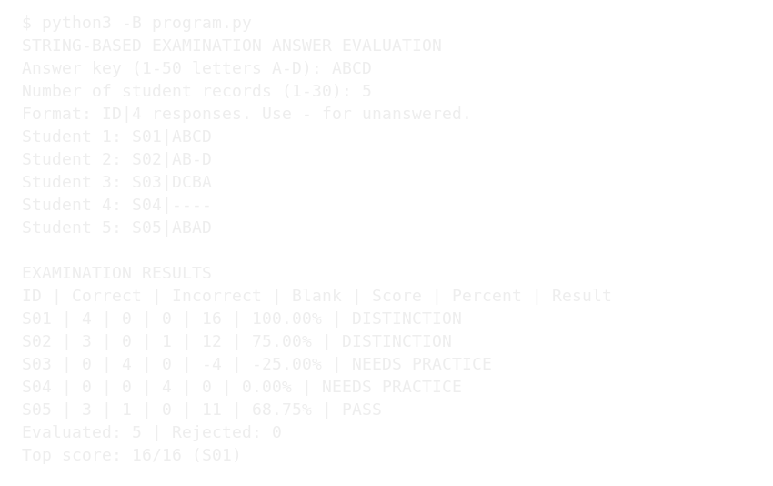

# Case Study 31: String-Based Examination Answer Evaluation

**Name:** Gottimukkala varsha

**Roll No:** 26000525

[Back to main page](../README.md)

## Problem Statement

Compare student answer strings with an answer key. Calculate correct, incorrect and unanswered responses, apply negative marking and display the results.

## Objectives

- Compare answers using string positions.
- Calculate scores and percentages.
- Classify results and identify tied top scores.

## Assumptions

- The key contains 1–50 letters from A to D. Letter case is normalized to uppercase.
- Accept 1–30 student-record attempts. IDs contain 1–12 ASCII letters or digits and normalize to uppercase.
- A correctly formatted record reserves a valid new ID even if its response string is later rejected. Duplicate IDs are not allowed.
- The response length must match the key. Allowed symbols are A–D and `-` for unanswered. Outer spaces are removed; spaces within a response are invalid.
- Correct answers earn 4 marks, incorrect answers lose 1 mark, and unanswered questions earn 0.
- Scores may be negative. Percentage = score × 100 / maximum score.
- At least 75% gives DISTINCTION; at least 50% gives PASS; otherwise the result is NEEDS PRACTICE.
- Invalid records are excluded. All students sharing the highest valid score are displayed.

## Algorithm

1. Read a valid answer key and student count.
2. Validate each student ID, response length and allowed symbols.
3. Compare each answer with the same position in the key.
4. Count correct, incorrect and unanswered responses.
5. Calculate the score, percentage and classification.
6. Store valid results and report invalid records.
7. Display results and identify the highest score and all ties.
8. If no record is valid, report that no top score is available.

## Flowchart


## Pseudocode

```text
START
Read valid answer key and student count
For each student record:
    Read ID and responses
    Validate ID, duplicate status, response length and symbols
    If invalid:
        Report rejection
    Else:
        Set correct, incorrect and unanswered to 0
        For each answer position:
            If response is '-': increase unanswered
            Else if response matches key: increase correct
            Else: increase incorrect
        score = 4 * correct - incorrect
        percentage = score * 100 / (4 * key length)
        If percentage >= 75: result = DISTINCTION
        Else if percentage >= 50: result = PASS
        Else: result = NEEDS PRACTICE
        Store the result
Display valid results and rejected count
Find the highest score, including negative scores
Display all top-scoring IDs or state that no valid result exists
STOP
```

## Python Program

[View program.py](program.py)

```bash
python3 31_answer_evaluation/program.py
```

Enter the answer key, student-record count and records in `ID|responses` format.

## Test Cases

| Test | Input or condition | Expected Result |
|---|---|---|
| 1 | Key `ABCD` and the five sample response strings | Scores are 16, 12, -4, 0 and 11. S01 has the highest score. |
| 2 | Key `AB`; responses `AB`, `ab` and `a-` | First two students tie at 8 marks. The third scores 4 and passes at 50%. |
| 3 | Key `ABCD`; one response `DCBA` | Score -4, percentage -25%. The negative score is still the top valid score. |
| 4 | Wrong response length, invalid symbol, duplicate ID or missing fields | Reject the records. If none are valid, show no top score. |
| 5 | Invalid or empty answer key and invalid count | Retry the setup inputs. |
| 6 | Key `ABCD`; responses `AB-D`, `AB--`, `A---` and `ABAD` | Percentages 75%, 50%, 25% and 68.75%; classifications follow the stated cutoffs. |

## Sample Input and Output

```text
ABCD
5
S01|ABCD
S02|AB-D
S03|DCBA
S04|----
S05|ABAD
```



## Conclusion

The program evaluates answer strings with positive and negative marking and handles unanswered questions and tied results.
