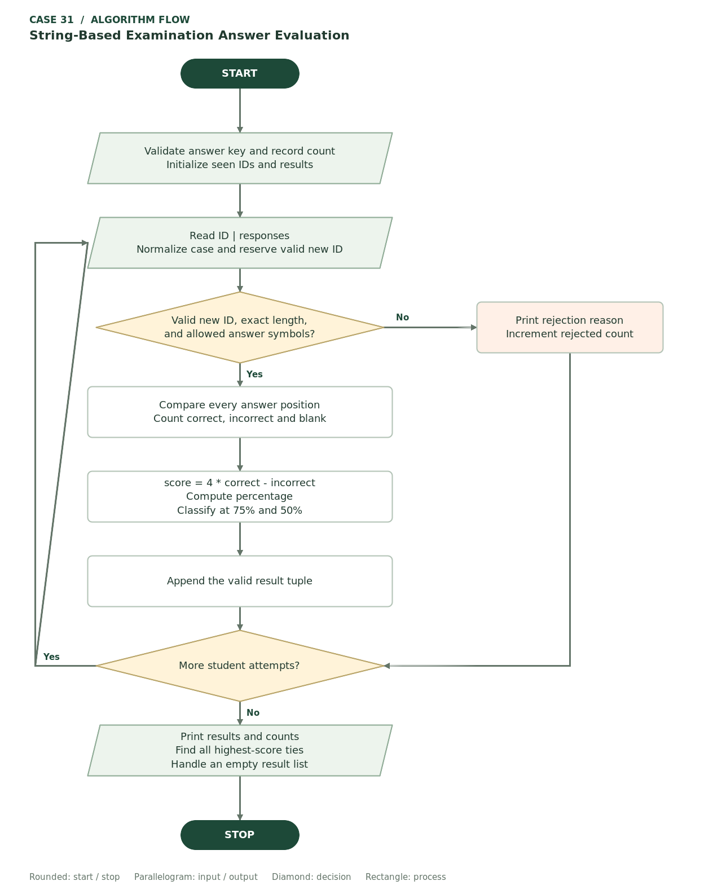
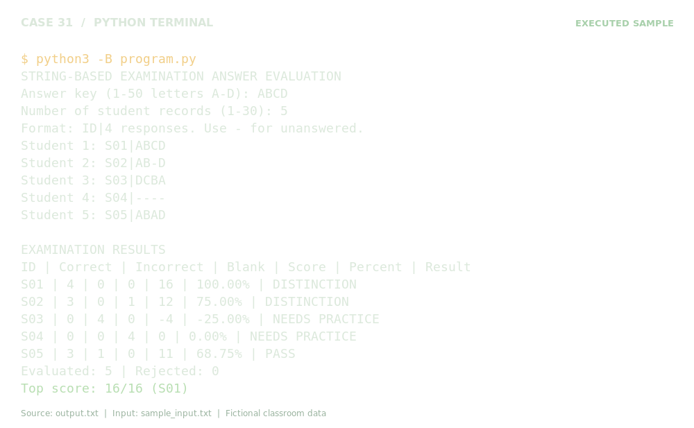

# Case 31: String-Based Examination Answer Evaluation

[← Portfolio index](../README.md) · [Complete report](../REPORT.html)

## Problem statement

Compare student answer strings with an answer key. Count correct, incorrect, and unanswered responses, apply positive and negative marking, classify results using stated thresholds, and identify all students tied for the top valid score.

## Objectives

- Validate answer strings before accessing matching character positions.
- Use string indexing to count three mutually exclusive response outcomes.
- Apply negative marking without silently clamping negative totals.
- Handle top-score ties and the case where no valid student record exists.

## Assumptions and policy

- The answer key contains 1-50 letters A-D; letter case is normalized. Accept 1-30 attempted student records.
- Student IDs contain 1-12 ASCII letters or digits and normalize to uppercase. A correctly shaped row with a valid new ID reserves the ID even if its answer string is invalid.
- Each response string has exactly the key length and contains A-D or '-' for unanswered. Outer whitespace is stripped; interior whitespace is invalid.
- Correct = +4 marks, incorrect = -1, unanswered = 0. Final scores may be negative. Maximum score = 4 * question_count.
- Percentage = score * 100 / maximum. At least 75% gives DISTINCTION, at least 50% gives PASS, otherwise NEEDS PRACTICE.
- Malformed student records count as attempts and are excluded from scores and ranking. All top-score ties are shown in input order.

## Input and output

**Input:** Enter the answer key, record count, and ID|responses for each student. Example: S02|AB-D for key ABCD.

**Output:** Rejected-record reasons; correct, incorrect, and unanswered counts; score, percentage and classification; evaluation totals; and top-score ties.

## Computational thinking

- Decomposition: validate the key, validate each record, score positions, and rank.
- Pattern recognition: each character position produces exactly one response outcome.
- Abstraction: an answer string is an ordered list of symbols, not free-form text.
- Algorithm design: initialize the maximum below the lowest possible score so all-negative results still rank correctly.

## Algorithm

1. Read and validate a nonempty key containing only A-D, then a valid student record count.
2. Validate each record's shape and unique ID, then its response length and permitted symbols.
3. For every answer position, count '-' as unanswered, an equal symbol as correct, and any other permitted symbol as incorrect.
4. Calculate score = 4 * correct - incorrect and percentage against the maximum.
5. Assign the classification using the 75% and 50% boundaries.
6. Store valid result tuples and print reasons for invalid records.
7. Print valid results and track the highest score, retaining all ties.
8. If none are valid, explicitly report that no top score is available.

## Flowchart



[Scalable SVG](assets/flowchart.svg) · [Mermaid source](flowchart.mmd)

## Pseudocode

```text
START
READ a valid answer_key of 1..50 symbols A-D
READ student_count in 1..30
seen_ids <- empty list; results <- empty list
FOR EACH attempted student record
    READ ID and responses; normalize letter case
    VALIDATE record, new ID, exact length, and symbols A-D or '-'
    RESERVE syntactically valid IDs in correctly shaped records
    IF invalid: PRINT reason and increment rejected
    ELSE
        correct <- 0; incorrect <- 0; unanswered <- 0
        FOR position FROM 0 TO key length - 1
            IF responses[position] = '-': increment unanswered
            ELSE IF responses[position] = key[position]: increment correct
            ELSE: increment incorrect
        score <- 4 * correct - incorrect
        percentage <- score * 100 / (4 * key length)
        IF percentage >= 75: classification <- DISTINCTION
        ELSE IF percentage >= 50: classification <- PASS
        ELSE: classification <- NEEDS PRACTICE
        APPEND result tuple
highest <- -(key length) - 1
FOR EACH result: PRINT result and UPDATE highest score and ties
PRINT evaluated and rejected counts
IF results is empty: PRINT no valid top score
ELSE: PRINT highest score and all tied IDs
STOP
```

## Python source code

[Runnable source](program.py). From the repository root:

```bash
python3 31_answer_evaluation/program.py
```

```python
print("STRING-BASED EXAMINATION ANSWER EVALUATION")
key_valid = False
while not key_valid:
    answer_key = input("Answer key (1-50 letters A-D): ").strip().upper()
    key_valid = 1 <= len(answer_key) <= 50
    for answer in answer_key:
        if answer not in "ABCD":
            key_valid = False
    if not key_valid:
        print("ERROR: the answer key must contain 1-50 letters A-D.")

count_text = input("Number of student records (1-30): ").strip()
while not count_text.isascii() or not count_text.isdigit() or not 1 <= int(count_text) <= 30:
    print("ERROR: enter an integer from 1 to 30.")
    count_text = input("Number of student records (1-30): ").strip()
student_count = int(count_text)
print(f"Format: ID|{len(answer_key)} responses. Use - for unanswered.")
seen_ids = []
results = []
rejected = 0

for record_number in range(1, student_count + 1):
    fields = input(f"Student {record_number}: ").split("|")
    reason = ""
    student_id = f"row-{record_number}"
    if len(fields) != 2:
        reason = "expected ID|responses"
    else:
        student_id = fields[0].strip().upper()
        responses = fields[1].strip().upper()
        if not 1 <= len(student_id) <= 12 or not student_id.isascii() or not student_id.isalnum():
            reason = "ID must contain 1-12 ASCII letters or digits"
        elif student_id in seen_ids:
            reason = "duplicate student ID"
        else:
            seen_ids.append(student_id)
            if len(responses) != len(answer_key):
                reason = "response length must match the answer key"
            else:
                for answer in responses:
                    if answer not in "ABCD-":
                        reason = "responses must contain only A-D or -"
            if reason == "":
                correct = 0
                incorrect = 0
                unanswered = 0
                for answer_index in range(len(answer_key)):
                    if responses[answer_index] == "-":
                        unanswered += 1
                    elif responses[answer_index] == answer_key[answer_index]:
                        correct += 1
                    else:
                        incorrect += 1
                score = correct * 4 - incorrect
                percentage = score * 100 / (len(answer_key) * 4)
                if percentage >= 75:
                    classification = "DISTINCTION"
                elif percentage >= 50:
                    classification = "PASS"
                else:
                    classification = "NEEDS PRACTICE"
                results.append((student_id, correct, incorrect, unanswered, score, percentage, classification))
    if reason != "":
        rejected += 1
        print(f"REJECTED {student_id}: {reason}")

print("\nEXAMINATION RESULTS")
print("ID | Correct | Incorrect | Blank | Score | Percent | Result")
highest_score = -len(answer_key) - 1
top_students = []
for student_id, correct, incorrect, unanswered, score, percentage, classification in results:
    print(f"{student_id} | {correct} | {incorrect} | {unanswered} | {score} | {percentage:.2f}% | {classification}")
    if score > highest_score:
        highest_score = score
        top_students = [student_id]
    elif score == highest_score:
        top_students.append(student_id)
print(f"Evaluated: {len(results)} | Rejected: {rejected}")
if len(results) > 0:
    print(f"Top score: {highest_score}/{len(answer_key) * 4} ({', '.join(top_students)})")
else:
    print("Top score: no valid student records")
```

## Test cases

Six automated fixtures cover normal, boundary, and validation behavior. Full stdin and assertions are in [tests.json](tests.json).

| Test | Type | Expected result | Actual result |
|---|---|---|---|
| `01_normal` | Normal | Scores 16, 12, -4, 0, 11. S01 ranks first; S02 has distinction and S05 passes. | PASS · [raw stdout](test_outputs/01_normal.txt) |
| `02_ties_and_normalization` | Boundary | S1 and S2 tie at 8; S3 passes at exactly 50%. | PASS · [raw stdout](test_outputs/02_ties_and_normalization.txt) |
| `03_all_incorrect` | Boundary | Score -4, percentage -25%; top valid score is -4, not zero. | PASS · [raw stdout](test_outputs/03_all_incorrect.txt) |
| `04_no_valid_students` | Validation | All four rejected; top score reported as unavailable. | PASS · [raw stdout](test_outputs/04_no_valid_students.txt) |
| `05_invalid_setup` | Validation | Key normalizes to AB. Scores are 8 and 0; both students are evaluated. | PASS · [raw stdout](test_outputs/05_invalid_setup.txt) |
| `06_classification_cutoffs` | Boundary | Classifications: distinction, pass, needs practice, pass. | PASS · [raw stdout](test_outputs/06_classification_cutoffs.txt) |

## Output screenshot

The image is a rendered capture of the actual pseudo-terminal execution of test `01_normal`. Typed sample inputs are visible in the transcript. Every sample is fictional.



[Full terminal transcript](output.txt) · [Exact sample input](sample_input.txt) · [Scalable output image](assets/output.svg)

```text
$ python3 -B program.py
STRING-BASED EXAMINATION ANSWER EVALUATION
Answer key (1-50 letters A-D): ABCD
Number of student records (1-30): 5
Format: ID|4 responses. Use - for unanswered.
Student 1: S01|ABCD
Student 2: S02|AB-D
Student 3: S03|DCBA
Student 4: S04|----
Student 5: S05|ABAD

EXAMINATION RESULTS
ID | Correct | Incorrect | Blank | Score | Percent | Result
S01 | 4 | 0 | 0 | 16 | 100.00% | DISTINCTION
S02 | 3 | 0 | 1 | 12 | 75.00% | DISTINCTION
S03 | 0 | 4 | 0 | -4 | -25.00% | NEEDS PRACTICE
S04 | 0 | 0 | 4 | 0 | 0.00% | NEEDS PRACTICE
S05 | 3 | 1 | 0 | 11 | 68.75% | PASS
Evaluated: 5 | Rejected: 0
Top score: 16/16 (S01)
```

## Conclusion

The scoring rules account for every response exactly once, including blanks and negative totals. Tests demonstrate correct threshold classifications, lowercase normalization, all-negative ranking, and a safe result when every record is invalid.
