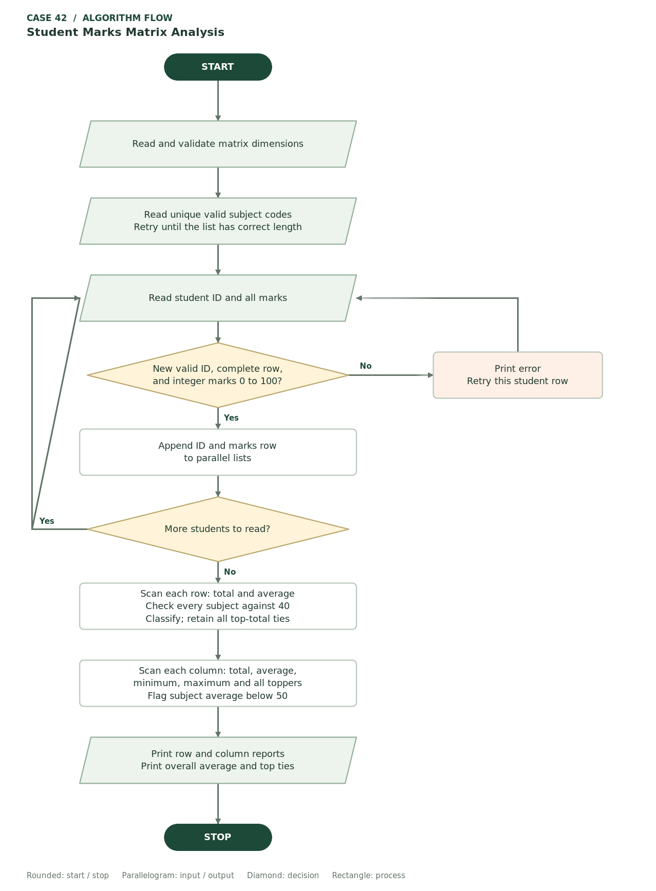
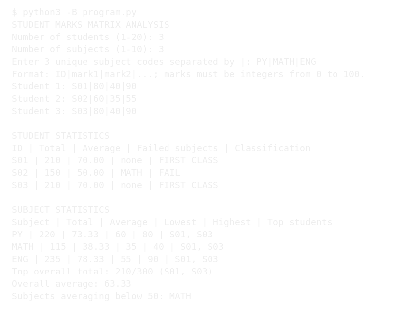

# Case Study 42: Student Marks Matrix Analysis

**Name:** Gottimukkala varsha

**Roll No:** 26000525

[Back to main page](../README.md)

## Problem Statement

Store student marks in a matrix and calculate student-wise and subject-wise statistics. Identify top performers and subjects with low average marks.

## Objectives

- Store marks using nested lists.
- Calculate totals and averages by rows and columns.
- Identify failed subjects, toppers and low-average subjects.

## Assumptions

- Accept 1–20 students and 1–10 subjects. Marks are whole numbers from 0 to 100.
- Student IDs and subject codes contain 1–12 ASCII letters or digits, normalize to uppercase and must be unique within their lists.
- Invalid subject lists or student rows are entered again. Every accepted row must contain one mark per subject.
- A student must score at least 40 in every subject. Any lower mark gives FAIL regardless of the overall average.
- For students passing all subjects: average at least 75 gives DISTINCTION; at least 60 gives FIRST CLASS; otherwise the result is PASS.
- A subject is flagged only when its class average is below 50. An average of exactly 50 is allowed.
- Overall toppers are selected by total marks, separately from pass status. Subject toppers are selected by that subject's mark. All ties are displayed.

## Algorithm

1. Read the student and subject counts.
2. Read and validate the subject codes.
3. Read each student ID and marks; store valid marks as a nested list.
4. Traverse each row to find total, average and failed subjects.
5. Classify the student and update the highest-total list.
6. Traverse each column to find total, average, minimum, maximum and subject toppers.
7. Identify subjects whose averages are below 50.
8. Display the student results, subject results and overall summary.

## Flowchart



## Pseudocode

```text
START
Read valid student and subject counts
Read unique subject codes
Read and validate each student ID and marks row
Store the accepted rows in a nested list
For each student row:
    Calculate total and average
    Collect subjects with marks below 40
    If any subject failed: classification = FAIL
    Else if average >= 75: classification = DISTINCTION
    Else if average >= 60: classification = FIRST CLASS
    Else: classification = PASS
    Display the student result
    Update overall top-total ties and grand total
For each subject column:
    Calculate total, average, lowest and highest mark
    Find all students sharing the highest mark
    If average < 50: add the subject to the low-average list
    Display the subject result
Display overall toppers, overall average and low-average subjects
STOP
```

## Python Program

[View program.py](program.py)

```bash
python3 42_marks_matrix/program.py
```

Enter student count, subject count, subject codes separated by `|`, then each row as `ID|mark1|mark2|...`.

## Test Cases

| Test | Input or condition | Expected Result |
|---|---|---|
| 1 | Three students and three subjects shown in the sample | S01 and S03 tie at 210. S02 fails MATH. MATH average is 38.33; overall average is 63.33. |
| 2 | One student, one subject, mark 0 | FAIL; subject is below the average threshold. |
| 3 | One student, one subject, mark 100 | DISTINCTION; no low-average subject. |
| 4 | Passing averages 75, 60 and 40; another student has marks 100 and 39 | DISTINCTION, FIRST CLASS and PASS for the first three cases. The last student fails despite an average of 69.50. |
| 5 | Invalid dimensions, duplicate IDs or subject codes, missing marks or marks outside 0–100 | Show an error and retry the affected input. |
| 6 | Rows A: 0,100; B: 50,50; C: 100,0 | All three tie at total 100. C tops the first subject and A tops the second. Both subject averages are 50. |

## Sample Input and Output

```text
3
3
PY|MATH|ENG
S01|80|40|90
S02|60|35|55
S03|80|40|90
```



## Conclusion

The program uses row and column traversal to analyze students and subjects while keeping subject-wise passing rules separate from average-based grades.
