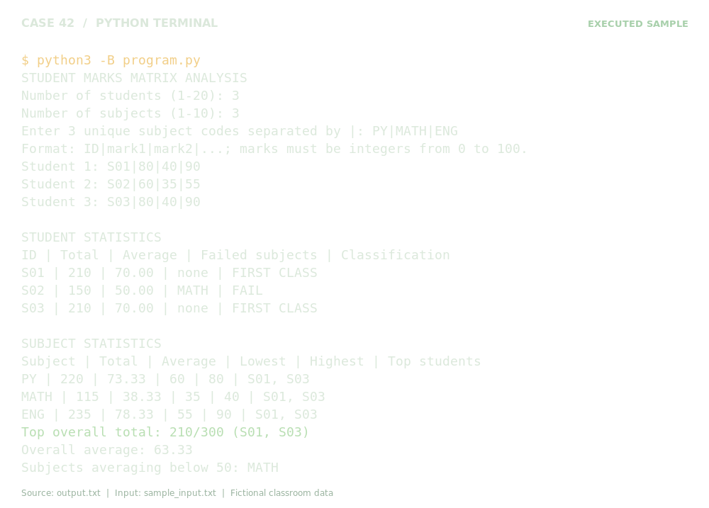

# Case 42: Student Marks Matrix Analysis

[← Portfolio index](../README.md) · [Complete report](../REPORT.html)

## Problem statement

Analyze a matrix of student marks across subjects. Calculate student totals and averages, determine classifications using subject-wise passing requirements, calculate subject totals, averages and extrema, identify tied top performers, and flag subjects with low average performance.

## Objectives

- Represent marks as a validated rectangular nested list.
- Traverse the matrix by rows for student statistics and by columns for subject statistics.
- Keep subject-wise pass criteria separate from average-based classifications.
- Report all top-score ties and subjects below a specified average.

## Assumptions and policy

- Accept 1-20 students and 1-10 subjects. Marks are whole numbers from 0 to 100, inclusive.
- Subject codes and student IDs contain 1-12 ASCII letters or digits, normalize to uppercase, and must be unique within their respective lists.
- Invalid subject lists and student rows are retried. The matrix is not analyzed until every requested row is valid and complete.
- A mark of at least 40 is required in every subject. Any lower mark makes the student FAIL regardless of average.
- Among students passing every subject: average >= 75 gives DISTINCTION; average >= 60 gives FIRST CLASS; all remaining passing averages give PASS.
- A subject is flagged when its class average is strictly below 50. Exactly 50 is not flagged.
- Overall top performers are determined by total marks across all valid students, independent of pass classification. Subject toppers use that subject's mark. Every tie is retained in input order.

## Input and output

**Input:** Enter student count, subject count, a pipe-separated subject-code list, then ID|mark1|...|markN for each student.

**Output:** Student totals, averages, failed subjects and classifications; subject totals, averages, lowest/highest marks and toppers; overall top ties, overall average, and low-average subject labels.

## Computational thinking

- Decomposition: validate matrix dimensions, calculate rows, calculate columns, and summarize.
- Pattern recognition: the same aggregation pattern applies to each row and each column.
- Abstraction: keep student identifiers and subject labels separate from the numeric matrix.
- Algorithm design: use nested index loops so each mark is attributed to its correct student and subject.

## Algorithm

1. Read valid student and subject counts.
2. Read a complete unique subject-code list; retry malformed lists.
3. Read student rows, validating ID uniqueness, exact mark count, and the 0-100 range.
4. Append each accepted ID and its marks list to parallel identifier and matrix lists.
5. For each row, sum marks, identify failed subjects, calculate the average, and apply classification rules.
6. Track the highest total and all tied student IDs while accumulating the grand total.
7. For each column, calculate total, average, minimum, maximum, and all subject toppers.
8. Flag averages below 50 and print the overall average, overall top ties, and weak subjects.

## Flowchart


[Scalable SVG](assets/flowchart.svg) · [Mermaid source](flowchart.mmd)

## Pseudocode

```text
START
READ student_count in 1..20 and subject_count in 1..10
READ exactly subject_count unique valid subject codes; RETRY errors
student_ids <- empty list; marks_matrix <- empty nested list
WHILE accepted students < student_count
    READ ID and subject_count marks
    CHECK new valid ID, correct row length, and integer marks 0..100
    IF invalid: PRINT error; RETRY
    ELSE: APPEND ID and the marks row
FOR EACH student row
    total <- 0; failed_subjects <- empty list
    FOR EACH subject column
        ADD mark to total
        IF mark < 40: APPEND subject label to failed_subjects
    average <- total / subject_count
    IF failed_subjects is not empty: classification <- FAIL
    ELSE IF average >= 75: classification <- DISTINCTION
    ELSE IF average >= 60: classification <- FIRST CLASS
    ELSE: classification <- PASS
    PRINT row statistics; UPDATE highest total and ties
    ADD total to grand_total
FOR EACH subject column
    SCAN all rows for total, minimum, maximum, and all maximum ties
    average <- total / student_count
    IF average < 50: APPEND subject to weak_subjects
    PRINT column statistics
PRINT overall top ties
PRINT grand_total / (student_count * subject_count)
PRINT weak_subjects or none
STOP
```

## Python source code

[Runnable source](program.py). From the repository root:

```bash
python3 42_marks_matrix/program.py
```

```python
print("STUDENT MARKS MATRIX ANALYSIS")
student_count_text = input("Number of students (1-20): ").strip()
while not student_count_text.isascii() or not student_count_text.isdigit() or not 1 <= int(student_count_text) <= 20:
    print("ERROR: enter an integer from 1 to 20.")
    student_count_text = input("Number of students (1-20): ").strip()
student_count = int(student_count_text)

subject_count_text = input("Number of subjects (1-10): ").strip()
while not subject_count_text.isascii() or not subject_count_text.isdigit() or not 1 <= int(subject_count_text) <= 10:
    print("ERROR: enter an integer from 1 to 10.")
    subject_count_text = input("Number of subjects (1-10): ").strip()
subject_count = int(subject_count_text)

subjects = []
while len(subjects) != subject_count:
    fields = input(f"Enter {subject_count} unique subject codes separated by |: ").split("|")
    subjects = []
    valid_subjects = len(fields) == subject_count
    for field in fields:
        subject = field.strip().upper()
        if not 1 <= len(subject) <= 12 or not subject.isascii() or not subject.isalnum() or subject in subjects:
            valid_subjects = False
        subjects.append(subject)
    if not valid_subjects:
        print("ERROR: use the correct number of unique ASCII alphanumeric subject codes.")
        subjects = []

student_ids = []
marks_matrix = []
print("Format: ID|mark1|mark2|...; marks must be integers from 0 to 100.")
while len(student_ids) < student_count:
    fields = input(f"Student {len(student_ids) + 1}: ").split("|")
    if len(fields) != subject_count + 1:
        print("ERROR: provide one ID and exactly one mark per subject.")
        continue
    student_id = fields[0].strip().upper()
    if not 1 <= len(student_id) <= 12 or not student_id.isascii() or not student_id.isalnum() or student_id in student_ids:
        print("ERROR: student IDs must be unique ASCII alphanumeric strings of 1-12 characters.")
        continue
    marks = []
    valid_marks = True
    for field in fields[1:]:
        mark_text = field.strip()
        if not mark_text.isascii() or not mark_text.isdigit() or not 0 <= int(mark_text) <= 100:
            valid_marks = False
        else:
            marks.append(int(mark_text))
    if not valid_marks:
        print("ERROR: each mark must be a whole number from 0 to 100.")
        continue
    student_ids.append(student_id)
    marks_matrix.append(marks)

print("\nSTUDENT STATISTICS")
print("ID | Total | Average | Failed subjects | Classification")
highest_total = -1
top_students = []
grand_total = 0
for student_index in range(student_count):
    total = 0
    failed_subjects = []
    for subject_index in range(subject_count):
        mark = marks_matrix[student_index][subject_index]
        total += mark
        if mark < 40:
            failed_subjects.append(subjects[subject_index])
    average = total / subject_count
    if len(failed_subjects) > 0:
        classification = "FAIL"
    elif average >= 75:
        classification = "DISTINCTION"
    elif average >= 60:
        classification = "FIRST CLASS"
    else:
        classification = "PASS"
    failed_text = "none"
    if len(failed_subjects) > 0:
        failed_text = ", ".join(failed_subjects)
    print(f"{student_ids[student_index]} | {total} | {average:.2f} | {failed_text} | {classification}")
    grand_total += total
    if total > highest_total:
        highest_total = total
        top_students = [student_ids[student_index]]
    elif total == highest_total:
        top_students.append(student_ids[student_index])

print("\nSUBJECT STATISTICS")
print("Subject | Total | Average | Lowest | Highest | Top students")
weak_subjects = []
for subject_index in range(subject_count):
    total = 0
    lowest = 101
    highest = -1
    subject_toppers = []
    for student_index in range(student_count):
        mark = marks_matrix[student_index][subject_index]
        total += mark
        if mark < lowest:
            lowest = mark
        if mark > highest:
            highest = mark
            subject_toppers = [student_ids[student_index]]
        elif mark == highest:
            subject_toppers.append(student_ids[student_index])
    average = total / student_count
    if average < 50:
        weak_subjects.append(subjects[subject_index])
    print(f"{subjects[subject_index]} | {total} | {average:.2f} | {lowest} | {highest} | {', '.join(subject_toppers)}")

print(f"Top overall total: {highest_total}/{subject_count * 100} ({', '.join(top_students)})")
print(f"Overall average: {grand_total / (student_count * subject_count):.2f}")
if len(weak_subjects) == 0:
    print("Subjects averaging below 50: none")
else:
    print(f"Subjects averaging below 50: {', '.join(weak_subjects)}")
```

## Test cases

Six automated fixtures cover normal, boundary, and validation behavior. Full stdin and assertions are in [tests.json](tests.json).

| Test | Type | Expected result | Actual result |
|---|---|---|---|
| `01_normal` | Normal | S01 and S03 tie at 210. S02 fails MATH. MATH average 38.33 is below 50; overall average 63.33. | PASS · [raw stdout](test_outputs/01_normal.txt) |
| `02_one_zero_mark` | Boundary | Student fails; subject average and all extrema are zero. | PASS · [raw stdout](test_outputs/02_one_zero_mark.txt) |
| `03_one_maximum_mark` | Boundary | Distinction, average 100, no weak subjects. | PASS · [raw stdout](test_outputs/03_one_maximum_mark.txt) |
| `04_classification_cutoffs` | Boundary | Distinction, first class, pass, fail, pass. S4 fails despite a 69.50 average. | PASS · [raw stdout](test_outputs/04_classification_cutoffs.txt) |
| `05_input_retries` | Validation | Only the two valid rows enter the matrix. Both average 50; subjects at exactly 50 are not flagged. | PASS · [raw stdout](test_outputs/05_input_retries.txt) |
| `06_subject_and_total_ties` | Boundary | All three tie at 100. C tops PY; A tops MA. Both subjects average exactly 50. | PASS · [raw stdout](test_outputs/06_subject_and_total_ties.txt) |

## Output screenshot

The image is a rendered capture of the actual pseudo-terminal execution of test `01_normal`. Typed sample inputs are visible in the transcript. Every sample is fictional.



[Full terminal transcript](output.txt) · [Exact sample input](sample_input.txt) · [Scalable output image](assets/output.svg)

```text
$ python3 -B program.py
STUDENT MARKS MATRIX ANALYSIS
Number of students (1-20): 3
Number of subjects (1-10): 3
Enter 3 unique subject codes separated by |: PY|MATH|ENG
Format: ID|mark1|mark2|...; marks must be integers from 0 to 100.
Student 1: S01|80|40|90
Student 2: S02|60|35|55
Student 3: S03|80|40|90

STUDENT STATISTICS
ID | Total | Average | Failed subjects | Classification
S01 | 210 | 70.00 | none | FIRST CLASS
S02 | 150 | 50.00 | MATH | FAIL
S03 | 210 | 70.00 | none | FIRST CLASS

SUBJECT STATISTICS
Subject | Total | Average | Lowest | Highest | Top students
PY | 220 | 73.33 | 60 | 80 | S01, S03
MATH | 115 | 38.33 | 35 | 40 | S01, S03
ENG | 235 | 78.33 | 55 | 90 | S01, S03
Top overall total: 210/300 (S01, S03)
Overall average: 63.33
Subjects averaging below 50: MATH
```

## Conclusion

The validated matrix supports both student and subject analysis without external libraries. Tests cover one-cell matrices, zero and full marks, exact classification thresholds, a failed subject despite a high average, and all forms of tied top scores.
