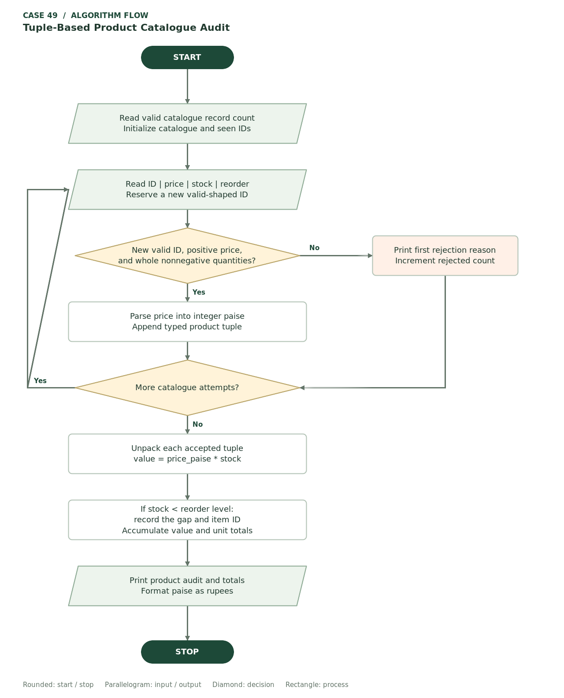
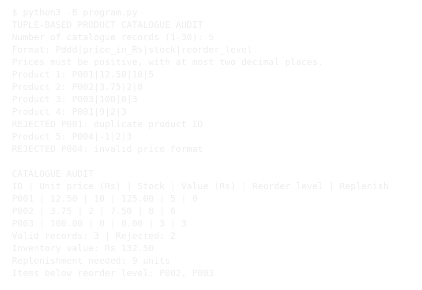

# Case Study 49: Tuple-Based Product Catalogue Audit

**Name:** Gottimukkala varsha

**Roll No:** 26000525

[Back to main page](../README.md)

## Problem Statement

Store product details in tuples, identify invalid or repeated records, calculate inventory value and find products that need replenishment.

## Objectives

- Validate product IDs, prices and quantities.
- Store and unpack product tuples.
- Calculate stock value and replenishment requirements.

## Assumptions

- Accept 1–30 product-record attempts. IDs are converted to uppercase and must be `P` followed by three ASCII digits.
- An ID is used up only when the whole record is accepted. If a record is rejected, the same ID may be used again by a later valid record. Duplicate IDs among accepted records are rejected.
- Prices must be positive, with a whole-number part and optionally one or two decimal places. Examples: `12`, `12.5` and `12.50`.
- Inputs such as `.50`, `1.`, negative prices or more than two decimal places are invalid.
- Prices are converted to integer paise for calculations and displayed in rupees.
- Stock and reorder levels are nonnegative whole numbers.
- Replenishment equals reorder level − stock only when stock is below the reorder level. Invalid records do not contribute to totals.

## Algorithm

1. Read the number of product records.
2. Validate the record format, product ID and duplicate status.
3. Split the price into whole and fractional parts and convert it to paise.
4. Check that price is positive and quantities are nonnegative whole numbers.
5. Store accepted records as product tuples.
6. Unpack each tuple and calculate stock value.
7. Calculate the replenishment gap and update totals.
8. Display valid products, rejected records, inventory value and replenishment details.

## Flowchart



## Pseudocode

```text
START
Read valid product-record count
Create empty catalogue and seen-ID lists
For each product record:
    Read ID, price, stock and reorder level
    Reject duplicate IDs (only accepted records count)
    Check price format and convert price to paise
    Check positive price and nonnegative whole quantities
    If valid:
        Store (ID, price_paise, stock, reorder_level) and record the ID as used
    Else:
        Display the first rejection reason
For each accepted tuple:
    value = price_paise * stock
    replenish = 0
    If stock < reorder_level:
        replenish = reorder_level - stock
        Record the product ID
    Add value and replenish to the totals
    Display the product details in rupees
Display total inventory value and replenishment details
STOP
```

## Python Program

[View program.py](program.py)

```bash
python3 49_product_catalogue/program.py
```

Record format: `Pddd|price_in_Rs|stock|reorder_level`.

## Test Cases

| Test | Input or condition | Expected Result |
|---|---|---|
| 1 | Five products shown in the sample | Three valid and two rejected. Inventory value: Rs 132.50. Replenishment: 9 units for P002 and P003. |
| 2 | Prices/stock: 0.01 × 3, 0.10 × 7 and 1.2 × 2 | Inventory value is Rs 3.13. One-digit fractional input is accepted. |
| 3 | Prices `0`, `1.234`, `1.2.3` and `.50` | Reject all four prices. |
| 4 | Invalid ID, repeated ID, negative stock or fractional stock | Reject the affected records and exclude them from totals. |
| 5 | Stock equal to or above each product's reorder level | No replenishment is required. |
| 6 | Count 0 followed by 2; a malformed record and a price of `1.` | Retry the count and reject both records. |

## Sample Input and Output

```text
5
P001|12.50|10|5
P002|3.75|2|8
P003|100|0|3
P001|9|2|3
P004|-1|2|3
```



## Conclusion

The program uses tuples to organize product details and calculates inventory value and stock requirements after validating each record.
