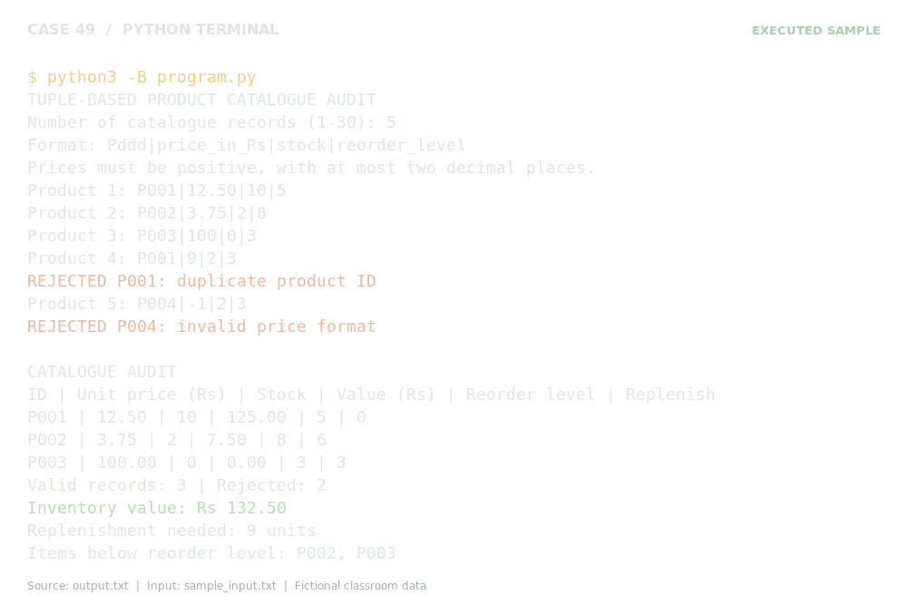

# Case 49: Tuple-Based Product Catalogue Audit

[← Portfolio index](../README.md) · [Complete report](../REPORT.html)

## Problem statement

Store product identifiers, unit prices, stock, and reorder levels as tuples. Audit malformed and duplicate records, calculate product and total inventory values, and identify the items and quantities requiring replenishment.

## Objectives

- Validate structured product identifiers and decimal-price strings.
- Convert prices into integer paise using only string and integer operations.
- Store immutable product records in tuples and unpack them for analysis.
- Exclude invalid records from inventory valuation and replenishment totals.

## Assumptions and policy

- Accept 1-30 attempted records. Product IDs normalize to uppercase and must be P followed by exactly three ASCII digits.
- The first correctly shaped row with a syntactically valid new ID reserves that ID, even if a later price or stock check fails. Repeated IDs are rejected.
- Prices are positive rupee amounts with a required integer part and optionally one or two decimal places: 12, 12.5, and 12.50 are valid; .50, 1., negatives, and excess precision are invalid.
- Convert prices to integer paise. Inventory arithmetic stays in paise; rupee conversion is only for display.
- Stock and reorder level are nonnegative whole units. A zero reorder level is permitted.
- Replenishment is reorder_level - stock when stock is lower, otherwise zero. Stock equal to the reorder level does not trigger replenishment.
- Invalid records count as attempts but contribute to neither inventory value nor replenishment. The report shows the first validation error for each rejected row.

## Input and output

**Input:** Enter the record count, then Pddd|price_in_Rs|stock|reorder_level. Example: P002|3.75|2|8.

**Output:** Rejected-record reasons; each valid product's unit price, stock, inventory value and replenishment; total value; total units needed; and item IDs below their reorder levels.

## Computational thinking

- Decomposition: validate identity, parse the price, validate quantities, and value inventory.
- Pattern recognition: every valid tuple supports the same stock-times-price calculation.
- Abstraction: use integer paise so decimal-input formatting does not control arithmetic accuracy.
- Algorithm design: reject invalid records before appending typed tuples to the catalogue.

## Algorithm

1. Read a valid record count and initialize the catalogue, seen IDs, and rejection count.
2. Validate four fields and the Pddd identifier; reject repeated IDs and reserve each new valid ID.
3. Split the price around the decimal point, require a digit-only integer part and at most two fractional digits, and pad a single fractional digit with zero.
4. Convert whole rupees and fractional paise to one positive integer price.
5. Validate stock and reorder level as nonnegative integers, then append the typed product tuple.
6. For each valid tuple, calculate value = unit_price_paise * stock.
7. Calculate the replenishment gap, retain below-level product IDs, and accumulate value and unit totals.
8. Print the catalogue audit, rejection count, total value, and replenishment summary.

## Flowchart


[Scalable SVG](assets/flowchart.svg) · [Mermaid source](flowchart.mmd)

## Pseudocode

```text
START
READ record_count in 1..30
catalogue <- empty list; seen_ids <- empty list
FOR EACH attempted record
    READ ID, price_text, stock_text, reorder_text
    CHECK four fields, Pddd ID format, and uniqueness
    RESERVE every new syntactically valid ID
    SPLIT price_text on decimal point
    REQUIRE one or two parts and an ASCII integer part
    IF a fraction is present: REQUIRE one or two ASCII digits
    PAD one fractional digit to two; absent fraction becomes 00
    price_paise <- integer_part * 100 + fractional_paise
    CHECK price_paise > 0 and nonnegative whole stock/reorder values
    IF valid: APPEND (ID, price_paise, stock, reorder_level)
    ELSE: PRINT reason; increment rejected
inventory_value <- 0; replenishment_units <- 0
FOR EACH (ID, price_paise, stock, reorder_level) IN catalogue
    value <- price_paise * stock
    replenish <- 0
    IF stock < reorder_level
        replenish <- reorder_level - stock
        RECORD ID for replenishment
    ACCUMULATE value and replenish
    PRINT product values formatted in rupees
PRINT valid/rejected counts, total value, units needed, and item IDs
STOP
```

## Python source code

[Runnable source](program.py). From the repository root:

```bash
python3 49_product_catalogue/program.py
```

```python
print("TUPLE-BASED PRODUCT CATALOGUE AUDIT")
count_text = input("Number of catalogue records (1-30): ").strip()
while not count_text.isascii() or not count_text.isdigit() or not 1 <= int(count_text) <= 30:
    print("ERROR: enter an integer from 1 to 30.")
    count_text = input("Number of catalogue records (1-30): ").strip()
record_count = int(count_text)
print("Format: Pddd|price_in_Rs|stock|reorder_level")
print("Prices must be positive, with at most two decimal places.")

catalogue = []
seen_ids = []
rejected = 0
for record_number in range(1, record_count + 1):
    fields = input(f"Product {record_number}: ").split("|")
    reason = ""
    product_id = f"row-{record_number}"
    if len(fields) != 4:
        reason = "expected four fields"
    else:
        product_id, price_text, stock_text, reorder_text = fields
        product_id = product_id.strip().upper()
        price_text = price_text.strip()
        stock_text = stock_text.strip()
        reorder_text = reorder_text.strip()
        if len(product_id) != 4 or product_id[0] != "P" or not product_id[1:].isascii() or not product_id[1:].isdigit():
            reason = "ID must be P followed by three ASCII digits"
        elif product_id in seen_ids:
            reason = "duplicate product ID"
        else:
            seen_ids.append(product_id)
            price_parts = price_text.split(".")
            price_valid = len(price_parts) in (1, 2)
            if price_valid:
                whole = price_parts[0]
                fraction = "00"
                price_valid = whole.isascii() and whole.isdigit()
                if len(price_parts) == 2:
                    fraction = price_parts[1]
                    price_valid = price_valid and 1 <= len(fraction) <= 2 and fraction.isascii() and fraction.isdigit()
                    fraction = (fraction + "00")[:2]
            if not price_valid:
                reason = "invalid price format"
            else:
                price_paise = int(whole) * 100 + int(fraction)
                if price_paise == 0:
                    reason = "price must be positive"
                elif not stock_text.isascii() or not stock_text.isdigit() or not reorder_text.isascii() or not reorder_text.isdigit():
                    reason = "stock and reorder level must be nonnegative whole numbers"
                else:
                    catalogue.append((product_id, price_paise, int(stock_text), int(reorder_text)))
    if reason != "":
        rejected += 1
        print(f"REJECTED {product_id}: {reason}")

print("\nCATALOGUE AUDIT")
print("ID | Unit price (Rs) | Stock | Value (Rs) | Reorder level | Replenish")
inventory_value = 0
replenishment_units = 0
reorder_items = []
for product_id, price_paise, stock, reorder_level in catalogue:
    value = price_paise * stock
    inventory_value += value
    replenish = 0
    if stock < reorder_level:
        replenish = reorder_level - stock
        reorder_items.append(product_id)
    replenishment_units += replenish
    print(f"{product_id} | {price_paise / 100:.2f} | {stock} | {value / 100:.2f} | {reorder_level} | {replenish}")

print(f"Valid records: {len(catalogue)} | Rejected: {rejected}")
print(f"Inventory value: Rs {inventory_value / 100:.2f}")
print(f"Replenishment needed: {replenishment_units} units")
if len(reorder_items) == 0:
    print("Items below reorder level: none")
else:
    print(f"Items below reorder level: {', '.join(reorder_items)}")
```

## Test cases

Six automated fixtures cover normal, boundary, and validation behavior. Full stdin and assertions are in [tests.json](tests.json).

| Test | Type | Expected result | Actual result |
|---|---|---|---|
| `01_normal` | Normal | Three valid, two rejected. Inventory value Rs 132.50; nine units needed across P002 and P003. | PASS · [raw stdout](test_outputs/01_normal.txt) |
| `02_exact_decimal_arithmetic` | Boundary | Values 0.03, 0.70, and 2.40 sum to exactly Rs 3.13. P003 needs one unit. | PASS · [raw stdout](test_outputs/02_exact_decimal_arithmetic.txt) |
| `03_invalid_prices` | Validation | All records rejected. Inventory value zero. | PASS · [raw stdout](test_outputs/03_invalid_prices.txt) |
| `04_ids_and_quantities` | Validation | All five rejected. The first syntactically valid P001 reserves its ID. | PASS · [raw stdout](test_outputs/04_ids_and_quantities.txt) |
| `05_reorder_boundary` | Boundary | All valid; inventory value 19.00; no replenishment. | PASS · [raw stdout](test_outputs/05_reorder_boundary.txt) |
| `06_malformed_and_count_retry` | Validation | Both attempted records rejected after count correction. | PASS · [raw stdout](test_outputs/06_malformed_and_count_retry.txt) |

## Output screenshot

The image is a rendered capture of the actual pseudo-terminal execution of test `01_normal`. Typed sample inputs are visible in the transcript. Every sample is fictional.



[Full terminal transcript](output.txt) · [Exact sample input](sample_input.txt) · [Scalable output image](assets/output.svg)

```text
$ python3 -B program.py
TUPLE-BASED PRODUCT CATALOGUE AUDIT
Number of catalogue records (1-30): 5
Format: Pddd|price_in_Rs|stock|reorder_level
Prices must be positive, with at most two decimal places.
Product 1: P001|12.50|10|5
Product 2: P002|3.75|2|8
Product 3: P003|100|0|3
Product 4: P001|9|2|3
REJECTED P001: duplicate product ID
Product 5: P004|-1|2|3
REJECTED P004: invalid price format

CATALOGUE AUDIT
ID | Unit price (Rs) | Stock | Value (Rs) | Reorder level | Replenish
P001 | 12.50 | 10 | 125.00 | 5 | 0
P002 | 3.75 | 2 | 7.50 | 8 | 6
P003 | 100.00 | 0 | 0.00 | 3 | 3
Valid records: 3 | Rejected: 2
Inventory value: Rs 132.50
Replenishment needed: 9 units
Items below reorder level: P002, P003
```

## Conclusion

The catalogue audit uses tuple records and integer money calculations to produce a repeatable inventory report. Tests cover one-paise prices, one-digit fractions, exact reorder boundaries, invalid decimal formats, and duplicate IDs following rejected records.
